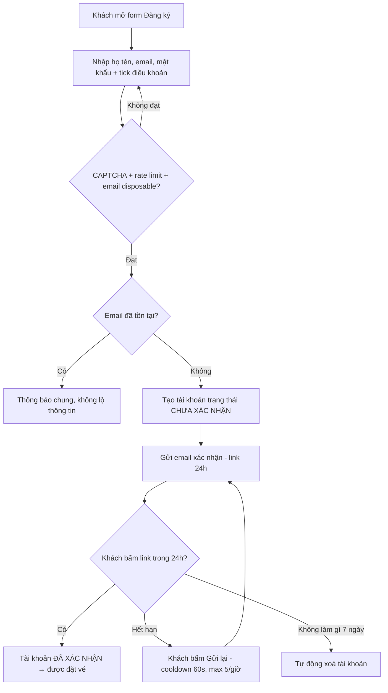
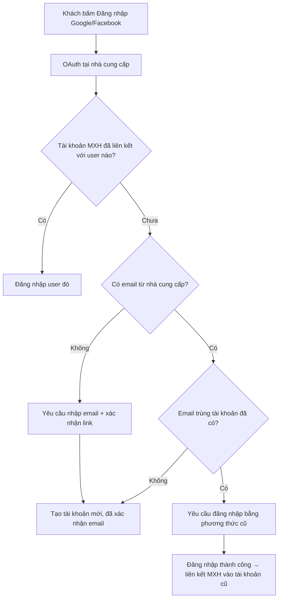
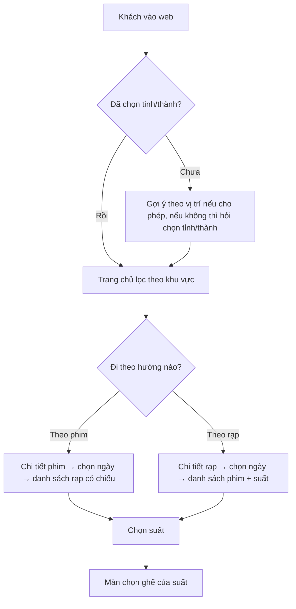
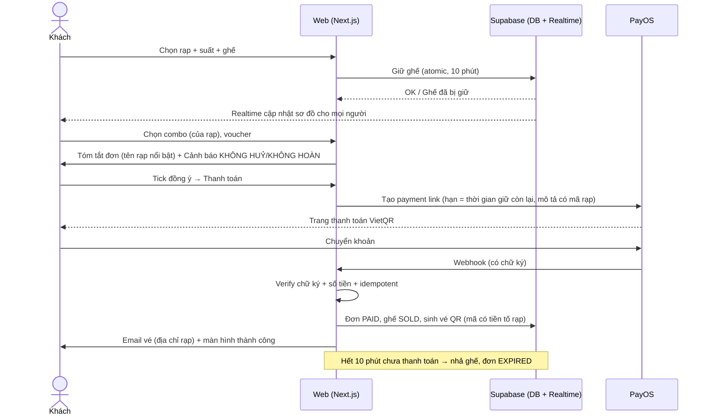
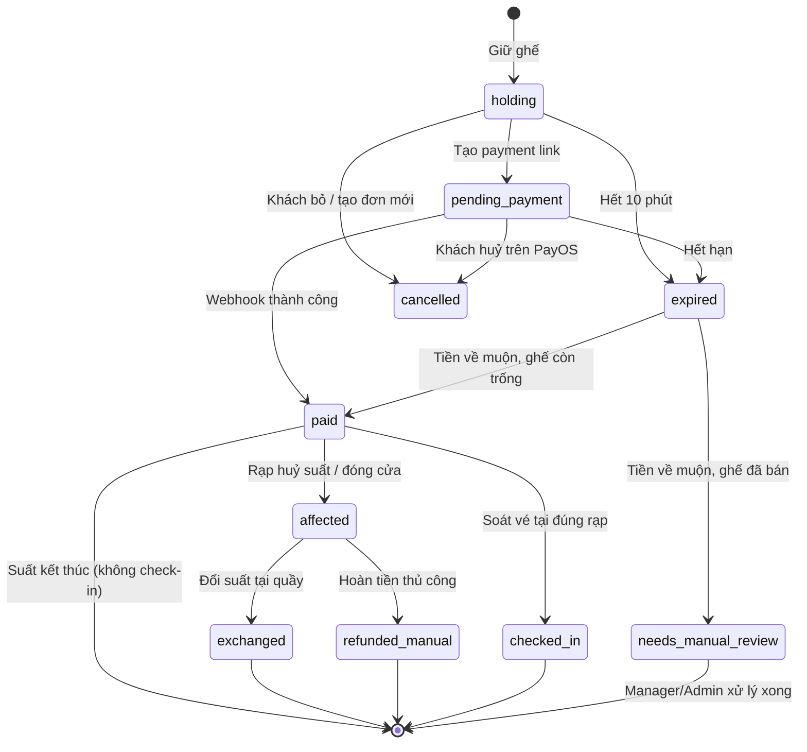

# BRD — Hệ thống Đặt vé Xem phim Online (Chuỗi rạp)

> **Business Requirements Document** · Tài liệu **intent** — chỉ thay đổi qua Change Request + người duyệt đồng ý (xem `AGENTS.md` § Doc Impact & Reconcile Rules).

## 0. Thông tin tài liệu

| Mục | Giá trị |
|---|---|
| Tên dự án | Web đặt vé xem phim cho **chuỗi nhiều rạp** |
| Phiên bản | 0.4 |
| Ngày tạo | 2026-11-10 |
| Trạng thái | Đã duyệt (Product Owner, 2026-11-10 — checkpoint brainstorm `/start`) |
| Công nghệ chốt | React + Next.js (frontend) + NestJS (backend API) + Supabase |
| Cổng thanh toán | PayOS (một tài khoản chung toàn chuỗi) |
| Tính chất dự án | **Dự án thử nghiệm / học tập** — quy mô khoảng **5 rạp**, chỉ deploy để demo, **không vận hành production thật** |

### Lịch sử sửa đổi

| Phiên bản | Ngày | Người sửa | Nội dung |
|---|---|---|---|
| 0.1 | 2026-11-10 | AI (Claude) | Bản nháp đầu tiên dựa trên yêu cầu cơ bản của chủ dự án (1 rạp) |
| 0.2 | 2026-11-10 | AI (Claude) | Change Request: chuyển từ **1 rạp** sang **chuỗi nhiều rạp** — thêm quản lý rạp, chọn rạp/khu vực, vai trò Cinema Manager, phân quyền theo rạp, bảng giá theo rạp, báo cáo theo rạp/toàn chuỗi |
| 0.3 | 2026-11-10 | AI (Claude) | Chốt câu hỏi mở Q1–Q9: đồng bộ khoá ghế với POS (module POS mới), bắt buộc đăng nhập, quy trình huỷ suất / đóng cửa rạp + email hàng loạt (ngoại lệ của chính sách không hoàn tiền), bỏ hoá đơn điện tử & phân loại giá, PayOS chung, voucher chỉ Admin, thu nhỏ quy mô về dự án demo ~5 rạp |
| 0.4 | 2026-11-10 | AI (Claude) | Cập nhật §10 công nghệ theo brainstorm (Next.js + NestJS + Supabase, Render, OpenStreetMap) — chỉ ràng buộc kỹ thuật, không đổi nghiệp vụ; Product Owner duyệt BRD |

### Người duyệt

| Vai trò | Họ tên | Ngày duyệt | Chữ ký |
|---|---|---|---|
| Chủ dự án / Product Owner | | | |
| Đại diện vận hành chuỗi rạp | | | |
| Tech Lead | | | |

---

## 1. Tóm tắt điều hành (Executive Summary)

Dự án xây dựng một website cho phép khách hàng **chọn rạp trong chuỗi, xem lịch chiếu, chọn ghế, mua vé và thanh toán online**. Chuỗi gồm **nhiều rạp** đặt tại nhiều tỉnh/thành; danh mục phim dùng chung toàn chuỗi, còn phòng chiếu, suất chiếu và giá vé được quản lý theo từng rạp. Khách đăng ký bằng email/mật khẩu (bắt buộc **xác nhận email** để chống spam) hoặc đăng nhập nhanh bằng **Google / Facebook**, có thể **liên kết** nhiều phương thức đăng nhập vào cùng một tài khoản. Thanh toán qua **PayOS** (chuyển khoản VietQR). Vé điện tử dạng **QR** được gửi qua email và soát tại cửa phòng chiếu của đúng rạp.

Chính sách bán vé áp dụng thống nhất toàn chuỗi: **khách không được huỷ vé, không được hoàn tiền**; hệ thống bắt buộc hiển thị cảnh báo và khách phải xác nhận trước khi thanh toán. Ngoại lệ duy nhất là khi **rạp huỷ suất chiếu hoặc đóng cửa** — khi đó khách được đổi suất tại quầy hoặc hoàn tiền thủ công, và hệ thống gửi email thông báo hàng loạt (xem §7).

Quầy vé (POS) tại rạp là **hệ thống riêng**, nhưng **dùng chung trạng thái khoá ghế** với web qua API: ghế nhân viên đang chọn trên POS bị khoá trên web và ngược lại, đảm bảo không bên nào bán trùng ghế của bên kia.

> **Phạm vi thực tế:** đây là dự án thử nghiệm/học tập. Hệ thống được xây đầy đủ nghiệp vụ như mô tả nhưng chỉ deploy để demo với khoảng **5 rạp** dữ liệu mẫu; các KPI và NFR về tải ở tài liệu này mang tính **tham chiếu thiết kế**, không phải cam kết vận hành.

---

## 2. Bối cảnh & vấn đề kinh doanh

### 2.1 Hiện trạng
- Khách phải đến quầy hoặc gọi điện để mua vé; không biết trước ghế nào còn trống, không so sánh được lịch chiếu giữa các rạp trong chuỗi.
- Giờ cao điểm (tối cuối tuần, phim bom tấn mở bán) quầy quá tải, khách bỏ về.
- Ban điều hành chuỗi không có dữ liệu tập trung: không so sánh được doanh thu, tỷ lệ lấp đầy giữa các rạp; mỗi rạp báo cáo thủ công.
- Thanh toán tiền mặt tại quầy tốn thời gian đối soát cuối ngày ở từng rạp.

### 2.2 Cơ hội
- Khách hàng mục tiêu (16–35 tuổi) quen mua online và thanh toán bằng QR ngân hàng.
- Một nền tảng chung giúp khách tìm suất phù hợp ở **rạp gần nhất** hoặc rạp khác khi rạp quen hết ghế → giữ khách trong chuỗi.
- Bán vé trước giúp chuỗi dự báo doanh thu, phân bổ phim/suất chiếu giữa các rạp, tối ưu nhân sự.
- Dữ liệu khách hàng tập trung (có đồng ý) phục vụ marketing toàn chuỗi.

---

## 3. Mục tiêu kinh doanh & KPI

> Dự án là bản demo nên các KPI dưới đây dùng làm **mục tiêu thiết kế** (hệ thống phải đo được các chỉ số này), không phải chỉ tiêu kinh doanh thực tế.

| # | Mục tiêu | KPI đo lường | Mốc |
|---|---|---|---|
| G1 | Chuyển dịch bán vé sang online | ≥ 40% tổng số vé toàn chuỗi bán qua web | 6 tháng sau go-live |
| G2 | Trải nghiệm đặt vé nhanh | Thời gian trung vị từ chọn suất → thanh toán xong ≤ 3 phút | Go-live |
| G3 | Không bán trùng ghế | 0 sự cố double-booking | Liên tục |
| G4 | Chặn tài khoản rác/spam | ≥ 95% tài khoản active đã xác nhận email; 0 đơn từ tài khoản chưa xác nhận | Liên tục |
| G5 | Tỷ lệ hoàn tất đơn | ≥ 70% phiên giữ ghế dẫn tới thanh toán thành công | 3 tháng sau go-live |
| G6 | Giảm tranh chấp do chính sách không hoàn tiền | 100% đơn có bản ghi khách đã xác nhận điều khoản; khiếu nại "không biết không được huỷ" ≤ 1% đơn | Liên tục |
| G7 | Giảm tải quầy | Thời gian chờ tại quầy giờ cao điểm giảm ≥ 50% ở mỗi rạp | 6 tháng sau go-live |
| G8 | Quản trị tập trung | 100% rạp dùng báo cáo trên hệ thống thay cho báo cáo thủ công; ban điều hành xem được số liệu toàn chuỗi theo ngày | 3 tháng sau go-live |
| G9 | Mở rạp mới nhanh | Thêm một rạp mới (thông tin, phòng, sơ đồ ghế, giá) và mở bán trong ≤ 1 ngày làm việc, không cần sửa code | Liên tục |

---

## 4. Phạm vi

### 4.1 Trong phạm vi (In-scope)
1. Đăng ký / đăng nhập email + mật khẩu, xác nhận email, quên/đặt lại mật khẩu.
2. Đăng nhập & liên kết / huỷ liên kết tài khoản **Google** và **Facebook**.
3. Quản lý hồ sơ khách hàng, rạp yêu thích, lịch sử đặt vé, xoá tài khoản.
4. Danh mục phim **dùng chung toàn chuỗi** (đang chiếu / sắp chiếu), chi tiết phim, tìm kiếm, lọc.
5. Quản lý **danh sách rạp** (theo tỉnh/thành), phòng chiếu, sơ đồ ghế, loại ghế, suất chiếu, bảng giá **theo từng rạp**.
6. Khách **chọn tỉnh/thành và rạp**, xem lịch chiếu theo rạp hoặc theo phim (so sánh nhiều rạp).
7. Đặt vé: chọn rạp → suất → chọn ghế (giữ ghế realtime) → combo bắp nước → mã giảm giá → cảnh báo không hoàn tiền → thanh toán PayOS.
8. Vé điện tử QR, email xác nhận đơn hàng.
9. Mã giảm giá (voucher) áp dụng toàn chuỗi hoặc giới hạn theo rạp.
10. Soát vé bằng quét QR (web trên điện thoại của nhân viên), giới hạn theo rạp của nhân viên.
11. Trang quản trị phân cấp: **Admin chuỗi** và **Quản lý rạp (Cinema Manager)**.
12. Báo cáo doanh thu, lấp đầy ghế theo **từng rạp** và **toàn chuỗi**.
13. **API đồng bộ khoá ghế với hệ thống POS** tại quầy (giữ / nhả / bán ghế) + **POS giả lập** đơn giản để demo và kiểm thử.
14. **Huỷ suất chiếu / đóng cửa rạp** bởi quản trị, đánh dấu đơn bị ảnh hưởng, **gửi email thông báo hàng loạt**, ghi nhận xử lý đổi suất / hoàn tiền thủ công.

### 4.2 Ngoài phạm vi (Out-of-scope) — giai đoạn hiện tại
- Nhiều thương hiệu / nhiều chuỗi rạp khác nhau trên cùng hệ thống (multi-tenant).
- Khách tự huỷ vé, đổi vé, đổi rạp; hoàn tiền **tự động** qua PayOS (hoàn tiền chỉ làm thủ công trong trường hợp rạp huỷ suất/đóng cửa — xem §7).
- Ứng dụng mobile native (iOS/Android).
- **Phần mềm POS thật** tại quầy (là hệ thống riêng) — dự án chỉ cung cấp API khoá ghế và một POS giả lập để demo.
- **Hoá đơn điện tử (VAT).**
- **Phân loại giá theo đối tượng** (HSSV, U22, người cao tuổi…).
- Vận hành production thật (SLA, trực sự cố, khách hàng thật).
- Chương trình tích điểm / hạng thành viên.
- Đa ngôn ngữ (chỉ tiếng Việt).
- Đánh giá / bình luận phim.
- Thanh toán thẻ quốc tế, ví điện tử khác ngoài PayOS.

---

## 5. Các bên liên quan & vai trò người dùng

### 5.1 Stakeholders

| Bên liên quan | Quan tâm chính |
|---|---|
| Chủ chuỗi / Product Owner | Doanh thu toàn chuỗi, so sánh hiệu quả giữa các rạp, chi phí vận hành |
| Admin chuỗi | Quản lý danh mục phim, rạp, voucher, người dùng; báo cáo toàn chuỗi |
| Quản lý rạp (Cinema Manager) | Xếp suất chiếu, cấu hình phòng/giá, quản lý nhân viên và báo cáo **của rạp mình** |
| Nhân viên soát vé (Staff) | Quét vé nhanh, phân biệt rõ vé hợp lệ / sai rạp / không hợp lệ |
| Khách hàng | Tìm rạp tiện nhất, đặt nhanh, chọn được ghế mong muốn, nhận vé ngay |
| Kế toán chuỗi | Đối soát giao dịch PayOS khớp đơn hàng, tách doanh thu theo rạp |
| Đội phát triển | Yêu cầu rõ ràng, khả thi trên Next.js + Supabase |

### 5.2 Vai trò người dùng (Actors)

| Vai trò | Phạm vi dữ liệu | Mô tả |
|---|---|---|
| **Guest** | Công khai | Chưa đăng nhập. Xem phim, rạp, lịch chiếu, sơ đồ ghế (chỉ xem). |
| **Customer (chưa xác nhận email)** | Của chính mình | Đã đăng ký nhưng chưa xác nhận. Xem được như Guest + hồ sơ; **không được đặt vé**. |
| **Customer** | Của chính mình | Đã xác nhận email (hoặc đăng nhập qua Google/Facebook có email đã xác minh). Đặt vé ở bất kỳ rạp nào. |
| **Staff** | **1 hoặc nhiều rạp được gán** | Nhân viên rạp. Soát vé, tra cứu vé — chỉ trong rạp được gán. |
| **Cinema Manager** | **1 hoặc nhiều rạp được gán** | Quản lý phòng, sơ đồ ghế, suất chiếu, giá, khoá ghế, nhân viên, báo cáo của rạp mình. |
| **Admin** | Toàn chuỗi | Toàn quyền: phim, rạp, voucher, người dùng & vai trò, cấu hình, báo cáo toàn chuỗi. |
| **POS (hệ thống ngoài)** | **1 rạp** (theo khoá API) | Phần mềm bán vé tại quầy. Không phải người dùng web; gọi API để giữ / nhả / bán ghế của các suất thuộc rạp mình (xem §6.14). |

### 5.3 Ma trận phân quyền

| Chức năng | Guest | Customer (chưa XN) | Customer | Staff | Cinema Manager | Admin |
|---|:-:|:-:|:-:|:-:|:-:|:-:|
| Xem phim, rạp, lịch chiếu, sơ đồ ghế | ✅ | ✅ | ✅ | ✅ | ✅ | ✅ |
| Đăng ký / đăng nhập | ✅ | — | — | — | — | — |
| Quản lý hồ sơ, liên kết tài khoản | — | ✅ | ✅ | ✅ | ✅ | ✅ |
| Giữ ghế, đặt vé, thanh toán | — | ❌ | ✅ | ❌ | ❌ | ❌ |
| Xem "Vé của tôi" | — | ✅ (rỗng) | ✅ | — | — | — |
| Soát vé (quét QR) | — | — | — | ✅ rạp mình | ✅ rạp mình | ✅ |
| Tra cứu đơn hàng | — | — | — | ✅ rạp mình (chỉ đọc) | ✅ rạp mình | ✅ |
| Quản lý danh mục phim | — | — | — | — | ❌ | ✅ |
| Quản lý danh sách rạp (thêm/sửa/đóng rạp) | — | — | — | — | ✏️ chỉ sửa thông tin rạp mình | ✅ |
| Quản lý phòng, sơ đồ ghế, suất chiếu, giá, khoá ghế, combo | — | — | — | — | ✅ rạp mình | ✅ |
| Quản lý voucher | — | — | — | — | 👁 xem | ✅ |
| Gán Staff cho rạp | — | — | — | — | ✅ rạp mình | ✅ |
| Quản lý người dùng & mọi vai trò | — | — | — | — | ❌ | ✅ |
| Báo cáo | — | — | — | — | ✅ rạp mình | ✅ toàn chuỗi |

> **Nguyên tắc phân quyền theo rạp:** mọi kiểm tra quyền của Staff / Cinema Manager phải đối chiếu `cinema_id` của dữ liệu với danh sách rạp được gán — thực thi ở **database (RLS)** và server, không chỉ ẩn trên giao diện.

---

## 6. Yêu cầu nghiệp vụ chi tiết

> Quy ước mã: `BR-<MODULE>-<số>`. Mức ưu tiên theo MoSCoW: **M** = Must, **S** = Should, **C** = Could.

### 6.1 Module AUTH — Đăng ký, đăng nhập, xác nhận email, chống spam

| Mã | Yêu cầu | Ưu tiên |
|---|---|:-:|
| BR-AUTH-01 | Khách đăng ký bằng **email + mật khẩu + họ tên**. Email là duy nhất trong hệ thống (không phân biệt hoa/thường). | M |
| BR-AUTH-02 | Chính sách mật khẩu: tối thiểu **8 ký tự**, có **chữ hoa, chữ thường và chữ số**; tối đa 72 ký tự. Hiển thị thanh độ mạnh mật khẩu. | M |
| BR-AUTH-03 | Khách phải tick đồng ý **Điều khoản sử dụng** và **Chính sách bảo mật** khi đăng ký; lưu thời điểm + phiên bản điều khoản đã đồng ý. | M |
| BR-AUTH-04 | Sau đăng ký, hệ thống **gửi email xác nhận** chứa link xác nhận một lần. Link **hết hạn sau 24 giờ**. | M |
| BR-AUTH-05 | Tài khoản **chưa xác nhận email không được giữ ghế / đặt vé**; giao diện hiển thị banner nhắc xác nhận + nút "Gửi lại email". | M |
| BR-AUTH-06 | Gửi lại email xác nhận: tối thiểu **60 giây** giữa 2 lần, tối đa **5 lần/giờ** cho mỗi email. | M |
| BR-AUTH-07 | **CAPTCHA** (Cloudflare Turnstile hoặc tương đương) bắt buộc ở form đăng ký, quên mật khẩu, và ở form đăng nhập sau **3 lần sai liên tiếp**. | M |
| BR-AUTH-08 | **Rate limit** đăng ký: tối đa **5 tài khoản/IP/giờ**; đăng nhập: tối đa **10 lần thử/IP/phút**. | M |
| BR-AUTH-09 | Chặn đăng ký bằng **email dùng một lần** (disposable email domain) theo danh sách đen có thể cập nhật. | S |
| BR-AUTH-10 | Tài khoản **chưa xác nhận sau 7 ngày** bị tự động xoá để giải phóng email. | S |
| BR-AUTH-11 | Đăng nhập sai mật khẩu **5 lần liên tiếp** → khoá đăng nhập bằng mật khẩu cho tài khoản đó **15 phút**; gửi email cảnh báo cho chủ tài khoản. | M |
| BR-AUTH-12 | Thông báo lỗi đăng nhập **không tiết lộ** email có tồn tại hay không ("Email hoặc mật khẩu không đúng"). Tương tự cho quên mật khẩu ("Nếu email tồn tại, chúng tôi đã gửi hướng dẫn"). | M |
| BR-AUTH-13 | **Quên mật khẩu**: gửi link đặt lại, hết hạn **1 giờ**, dùng một lần. Đặt lại thành công → đăng xuất mọi phiên khác. | M |
| BR-AUTH-14 | **Đổi mật khẩu** khi đã đăng nhập: yêu cầu nhập mật khẩu hiện tại. Gửi email thông báo sau khi đổi. | M |
| BR-AUTH-15 | Chức năng **"Đăng xuất khỏi mọi thiết bị"** trong trang hồ sơ. | S |
| BR-AUTH-16 | Phiên đăng nhập: duy trì tối đa **30 ngày** nếu chọn "Ghi nhớ đăng nhập", ngược lại hết khi đóng trình duyệt; tự gia hạn token ngầm. | S |
| BR-AUTH-17 | Sau khi đăng nhập, quay về đúng trang khách đang thao tác (vd đang chọn ghế thì quay lại màn chọn ghế của suất đó). | M |
| BR-AUTH-18 | Tài khoản nhân sự (Staff, Cinema Manager, Admin) **chỉ do Admin/Manager tạo hoặc nâng quyền**; khách không thể tự đăng ký vai trò nhân sự. | M |

### 6.2 Module SOCIAL — Đăng nhập & liên kết Google / Facebook

| Mã | Yêu cầu | Ưu tiên |
|---|---|:-:|
| BR-SOC-01 | Khách có thể **đăng nhập / đăng ký nhanh bằng Google** (OAuth). | M |
| BR-SOC-02 | Khách có thể **đăng nhập / đăng ký nhanh bằng Facebook** (OAuth). | M |
| BR-SOC-03 | Tài khoản tạo qua Google/Facebook với email đã được nhà cung cấp xác minh → coi như **đã xác nhận email**, được đặt vé ngay. | M |
| BR-SOC-04 | Facebook không trả về email (khách ẩn email / đăng ký FB bằng SĐT) → bắt buộc khách **nhập email và xác nhận qua link** như BR-AUTH-04 trước khi được đặt vé. | M |
| BR-SOC-05 | **Trùng email với tài khoản đã có**: hệ thống **không tự động gộp**. Hiển thị "Email này đã có tài khoản — hãy đăng nhập bằng phương thức cũ để liên kết". Sau khi khách đăng nhập tài khoản cũ thành công, thực hiện liên kết. | M |
| BR-SOC-06 | Trong trang **Hồ sơ → Bảo mật & liên kết**, khách xem được các phương thức đăng nhập đang liên kết (Email/mật khẩu, Google, Facebook) và có nút **Liên kết** / **Huỷ liên kết**. | M |
| BR-SOC-07 | **Không cho huỷ liên kết phương thức đăng nhập cuối cùng** còn lại của tài khoản. | M |
| BR-SOC-08 | Tài khoản chỉ có Google/Facebook có thể **thêm mật khẩu** (đặt mật khẩu lần đầu) để đăng nhập bằng email. | S |
| BR-SOC-09 | Một tài khoản Google/Facebook chỉ được liên kết với **tối đa 1** tài khoản trong hệ thống. Cố liên kết tài khoản MXH đã thuộc người khác → báo lỗi. | M |
| BR-SOC-10 | Gửi email thông báo mỗi khi **liên kết hoặc huỷ liên kết** một phương thức đăng nhập. | S |
| BR-SOC-11 | Chỉ yêu cầu quyền tối thiểu từ nhà cung cấp: email, tên, ảnh đại diện. | M |
| BR-SOC-12 | Có trang **Hướng dẫn xoá dữ liệu** (Data Deletion Instructions URL) theo yêu cầu của Facebook App Review. | M |

### 6.3 Module PROFILE — Hồ sơ khách hàng

| Mã | Yêu cầu | Ưu tiên |
|---|---|:-:|
| BR-PRO-01 | Khách xem/sửa: họ tên, số điện thoại, ngày sinh, giới tính (tuỳ chọn), ảnh đại diện. | M |
| BR-PRO-02 | **Đổi email**: gửi link xác nhận tới email mới; chỉ đổi khi đã xác nhận; thông báo tới email cũ. | S |
| BR-PRO-03 | Ảnh đại diện: JPG/PNG/WebP, ≤ 2 MB, tự resize. | C |
| BR-PRO-04 | **Xoá tài khoản**: khách yêu cầu xoá → xác nhận lại bằng mật khẩu/OAuth → ẩn danh hoá dữ liệu cá nhân; **giữ lại dữ liệu đơn hàng** (ẩn danh) phục vụ kế toán theo luật. Vé chưa sử dụng sẽ mất hiệu lực (cảnh báo trước khi xoá). | M |
| BR-PRO-05 | Tuỳ chọn nhận email khuyến mãi (opt-in, mặc định tắt). Email giao dịch (vé, bảo mật) luôn gửi. | S |
| BR-PRO-06 | Khách chọn **rạp yêu thích** (một hoặc nhiều); rạp yêu thích được ưu tiên hiển thị ở trang chủ và lịch chiếu. | S |

### 6.4 Module CHAIN — Quản lý chuỗi rạp & chọn rạp

| Mã | Yêu cầu | Ưu tiên |
|---|---|:-:|
| BR-CHN-01 | Admin quản lý **danh sách rạp**: tên, mã rạp (ngắn, duy nhất — dùng trên vé), tỉnh/thành, quận/huyện, địa chỉ, toạ độ bản đồ, hotline, email, giờ mở cửa, ảnh, tiện ích (bãi xe, thang máy…), trạng thái **Đang hoạt động / Sắp khai trương / Tạm đóng / Ngừng hoạt động**. | M |
| BR-CHN-02 | Rạp **Tạm đóng / Ngừng hoạt động** không hiển thị suất mới cho khách. Đóng cửa rạp còn suất **đã bán vé** trong tương lai → hệ thống bắt buộc chạy quy trình **huỷ hàng loạt các suất đó** (BR-ADM-12) trước khi đổi trạng thái rạp. | M |
| BR-CHN-03 | Trang **Danh sách rạp** cho khách: nhóm theo tỉnh/thành, có bản đồ, địa chỉ, hotline, nút "Xem lịch chiếu". | M |
| BR-CHN-04 | Khách **chọn tỉnh/thành** ở header; lựa chọn được ghi nhớ (trình duyệt + hồ sơ nếu đăng nhập) và lọc mọi lịch chiếu theo khu vực đó. | M |
| BR-CHN-05 | **Gợi ý rạp gần nhất** dựa trên vị trí thiết bị — chỉ khi khách cho phép định vị; từ chối thì dùng tỉnh/thành đã chọn. | S |
| BR-CHN-06 | Trang **chi tiết rạp**: thông tin rạp + lịch chiếu 7 ngày tới của rạp đó, nhóm theo phim. | M |
| BR-CHN-07 | Mở **rạp mới** hoàn toàn qua trang quản trị (tạo rạp → phòng → sơ đồ ghế → bảng giá → suất chiếu), không cần sửa code hay deploy. | M |
| BR-CHN-08 | Mỗi Staff / Cinema Manager được **gán một hoặc nhiều rạp**; mọi màn hình quản trị của họ có bộ chọn rạp (chỉ liệt kê rạp được gán). | M |

### 6.5 Module MOVIE — Danh mục phim (dùng chung toàn chuỗi)

| Mã | Yêu cầu | Ưu tiên |
|---|---|:-:|
| BR-MOV-01 | Trang chủ hiển thị banner phim nổi bật, tab **Đang chiếu** và **Sắp chiếu** (theo khu vực đã chọn: phim "đang chiếu" = có suất tại ít nhất một rạp trong khu vực). | M |
| BR-MOV-02 | Thông tin phim (quản lý tập trung bởi Admin): tên (VN + gốc), poster, banner, trailer (YouTube embed), mô tả, thể loại, thời lượng, đạo diễn, diễn viên, quốc gia, ngôn ngữ / phụ đề / lồng tiếng, ngày khởi chiếu, **nhãn phân loại độ tuổi**. | M |
| BR-MOV-03 | Nhãn phân loại theo quy định Việt Nam: **P** (mọi lứa tuổi), **K** (dưới 13 tuổi xem cùng người giám hộ), **T13**, **T16**, **T18**. Hiển thị rõ ở danh sách, chi tiết, màn chọn ghế và trên vé. | M |
| BR-MOV-04 | Tìm kiếm phim theo tên; lọc theo thể loại, **tỉnh/thành, rạp**, ngày chiếu, định dạng (2D/3D). | S |
| BR-MOV-05 | Trang chi tiết phim hiển thị lịch chiếu **7 ngày tới**: chọn ngày → danh sách **các rạp có chiếu** (rạp yêu thích / gần nhất lên đầu) → các suất theo định dạng. | M |
| BR-MOV-06 | Phim "Sắp chiếu" chưa có suất → hiển thị ngày khởi chiếu, không có nút đặt vé. | M |
| BR-MOV-07 | Trang phim và trang rạp tối ưu **SEO** (SSR/ISR, meta title/description, Open Graph để chia sẻ). | S |

### 6.6 Module CINEMA — Phòng chiếu, sơ đồ ghế, suất chiếu, giá (theo từng rạp)

| Mã | Yêu cầu | Ưu tiên |
|---|---|:-:|
| BR-CIN-01 | Mỗi **phòng chiếu thuộc đúng một rạp**. Cinema Manager quản lý phòng của rạp mình: tên, định dạng hỗ trợ (2D/3D), trạng thái hoạt động/bảo trì. | M |
| BR-CIN-02 | Dựng **sơ đồ ghế** dạng lưới hàng (A, B, C…) × cột; mỗi ô là: ghế **Thường**, **VIP**, **Đôi (Sweetbox — chiếm 2 ô, bán theo cặp)**, lối đi, hoặc ghế hỏng/khoá. Có thể **sao chép sơ đồ** từ phòng khác (kể cả của rạp khác) để dựng nhanh. | M |
| BR-CIN-03 | **Suất chiếu** = rạp + phòng + phim + ngày giờ bắt đầu + định dạng + ngôn ngữ (phụ đề/lồng tiếng). Giờ kết thúc = giờ bắt đầu + thời lượng phim + **thời gian dọn phòng** (mặc định 15 phút, cấu hình theo rạp). | M |
| BR-CIN-04 | **Không cho tạo suất chồng giờ** trong cùng phòng (tính cả thời gian dọn phòng). | M |
| BR-CIN-05 | **Bảng giá hai cấp**: Admin đặt **bảng giá mặc định toàn chuỗi** theo loại ghế × định dạng × loại ngày (thường / cuối tuần / lễ) × khung giờ (trước 17h / sau 17h); Cinema Manager có thể **ghi đè giá cho rạp mình** và ghi đè cho từng suất (vd suất chiếu sớm). Giá áp dụng = ghi đè suất › ghi đè rạp › mặc định chuỗi. | M |
| BR-CIN-06 | **Ngày lễ** do Admin quản lý chung toàn chuỗi; áp giá ngày lễ ở mọi rạp. | S |
| BR-CIN-07 | Suất đã có vé bán ra **không được xoá, không được đổi giờ/phòng/phim**; chỉ được **đóng bán** (ngừng bán tiếp) hoặc **huỷ suất** theo quy trình BR-ADM-12. | M |
| BR-CIN-08 | Cinema Manager có thể **khoá ghế** cho một suất của rạp mình (giữ cho khách mời/ghế hỏng) — ghế khoá hiển thị không bán được. | S |
| BR-CIN-09 | **Combo bắp nước**: Admin định nghĩa danh mục combo chung; mỗi rạp bật/tắt combo và có thể đặt giá riêng. | S |
| BR-CIN-10 | Mọi thời gian suất chiếu hiển thị theo giờ Việt Nam (Asia/Ho_Chi_Minh) — áp dụng cho mọi rạp. | M |

### 6.7 Module BOOKING — Đặt vé & giữ ghế

**Luồng chính:** Chọn khu vực → chọn phim rồi rạp (hoặc chọn rạp rồi phim) → chọn ngày & suất → chọn ghế → chọn combo (tuỳ chọn) → nhập mã giảm giá (tuỳ chọn) → xem tóm tắt đơn + **cảnh báo không huỷ/không hoàn tiền** → xác nhận → thanh toán PayOS → nhận vé QR.

| Mã | Yêu cầu | Ưu tiên |
|---|---|:-:|
| BR-BKG-01 | Sơ đồ ghế hiển thị trạng thái: **Trống**, **Đang được giữ** (bởi khách khác trên web **hoặc nhân viên trên POS** — khách không phân biệt nguồn), **Đã bán** (web hoặc POS), **Đang chọn** (của tôi), **Khoá**; có chú thích màu và giá theo loại ghế. | M |
| BR-BKG-02 | Trạng thái ghế cập nhật **realtime** cho tất cả người đang xem cùng suất (không cần tải lại trang). | M |
| BR-BKG-03 | Khi khách bấm "Tiếp tục" sau khi chọn ghế, hệ thống **giữ ghế 10 phút**; hiển thị **đồng hồ đếm ngược** trên mọi bước tiếp theo. | M |
| BR-BKG-04 | Việc giữ ghế phải **nguyên tử (atomic)**: nếu bất kỳ ghế nào trong lựa chọn đã bị người khác giữ/bán → toàn bộ yêu cầu giữ thất bại, báo ghế nào bị trùng để khách chọn lại. **Tuyệt đối không bán trùng ghế** (ràng buộc ở tầng database). | M |
| BR-BKG-05 | Hết 10 phút mà chưa thanh toán thành công → **tự động nhả ghế**, đơn chuyển trạng thái `expired`, khách được đưa về màn chọn ghế với thông báo. | M |
| BR-BKG-06 | Mỗi khách chỉ có **1 đơn đang giữ ghế** tại một thời điểm (trên toàn chuỗi); tạo đơn mới sẽ huỷ đơn giữ cũ (nhả ghế). | M |
| BR-BKG-07 | Mỗi đơn chỉ thuộc **một suất chiếu** (do đó một rạp). Tối đa **8 ghế/đơn**. Ghế đôi tính là 2 ghế. | M |
| BR-BKG-08 | **Không để trống 1 ghế lẻ** giữa các ghế đã chọn/đã bán hoặc giữa ghế đã chọn và lối đi/tường (trừ khi sơ đồ không còn cách chọn khác). Vi phạm → báo và chặn bước tiếp. | S |
| BR-BKG-09 | Đóng bán online **15 phút trước giờ chiếu** (mặc định chuỗi, Cinema Manager cấu hình được cho rạp mình). Sau mốc này suất hiển thị "Ngừng bán online — vui lòng mua tại quầy". | M |
| BR-BKG-10 | Phim **T13/T16/T18**: hiển thị cảnh báo độ tuổi, khách phải tick xác nhận "Tất cả người xem đủ tuổi theo quy định"; nhân viên **có quyền yêu cầu giấy tờ và từ chối vào phòng** — vé không được hoàn (nêu rõ trong cảnh báo). Nếu ngày sinh trong hồ sơ cho thấy khách chưa đủ tuổi → chặn đặt vé. | M |
| BR-BKG-11 | Bước **Combo bắp nước**: chỉ hiển thị combo đang bật tại **rạp của suất**; chọn số lượng; hiển thị ảnh, mô tả, giá. Combo được nhận tại quầy của đúng rạp bằng QR của vé. | S |
| BR-BKG-12 | Màn **Tóm tắt đơn**: **tên + địa chỉ rạp** (nổi bật, tránh nhầm rạp), phim, nhãn tuổi, suất, phòng, danh sách ghế, combo, tạm tính, giảm giá, **tổng tiền**. | M |
| BR-BKG-13 | **Cảnh báo không huỷ / không hoàn tiền** (bắt buộc — xem §7): hiển thị hộp thoại trước khi chuyển sang thanh toán, **nhắc rõ tên rạp + giờ chiếu**; khách phải **tick checkbox xác nhận** thì nút "Thanh toán" mới bật. Hệ thống **lưu bằng chứng** đồng ý (thời điểm, nội dung/phiên bản điều khoản, user, đơn). | M |
| BR-BKG-14 | Giá trong đơn được **chốt tại thời điểm giữ ghế**; thay đổi giá sau đó không ảnh hưởng đơn đang giữ. | M |

### 6.8 Module PAYMENT — Thanh toán PayOS

| Mã | Yêu cầu | Ưu tiên |
|---|---|:-:|
| BR-PAY-01 | Thanh toán qua **PayOS**: hệ thống tạo **payment link** (mã đơn số duy nhất `orderCode`, số tiền, mô tả có **mã rạp + mã đặt vé**, `returnUrl`, `cancelUrl`), khách quét **VietQR** hoặc chuyển khoản theo thông tin PayOS cung cấp. | M |
| BR-PAY-02 | Thời hạn payment link **bằng thời gian giữ ghế còn lại** (không vượt quá mốc hết hạn giữ ghế). | M |
| BR-PAY-03 | Xác nhận thanh toán **chỉ dựa trên webhook PayOS** (hoặc truy vấn trạng thái từ server), **không** tin vào tham số trên `returnUrl`. Webhook phải được **kiểm tra chữ ký (checksum key)**; sai chữ ký → bỏ qua + ghi log cảnh báo. | M |
| BR-PAY-04 | Xử lý webhook **idempotent**: cùng một giao dịch gửi nhiều lần chỉ ghi nhận một lần. Kiểm tra **số tiền nhận = tổng tiền đơn**. | M |
| BR-PAY-05 | Thanh toán thành công → đơn `paid`, ghế chuyển `sold`, sinh vé QR, gửi email vé (trong ≤ 1 phút). | M |
| BR-PAY-06 | Khách bấm huỷ trên trang PayOS hoặc link hết hạn → đơn `cancelled`/`expired`, nhả ghế ngay. | M |
| BR-PAY-07 | **Thanh toán đến muộn** (tiền về sau khi giữ ghế đã hết hạn): nếu ghế **vẫn còn trống** → tự động chốt bán cho khách; nếu ghế **đã bán cho người khác** → đơn chuyển `needs_manual_review`, báo Admin + Cinema Manager của rạp đó, email khách hướng dẫn liên hệ rạp. (Trường hợp ngoại lệ duy nhất có thể phát sinh xử lý tiền thủ công — xem §7.3.) | M |
| BR-PAY-08 | Khi quay về `returnUrl`, khách thấy màn **"Đang xác nhận thanh toán"** (polling trạng thái) cho tới khi có kết quả; không bắt khách bấm lại. | M |
| BR-PAY-09 | Hệ thống có **job đối soát** định kỳ (vd mỗi 5 phút) truy vấn PayOS các đơn `pending` quá hạn để phát hiện webhook bị lỡ. | M |
| BR-PAY-10 | Không lưu thông tin tài khoản ngân hàng / thẻ của khách. Chỉ lưu mã giao dịch, số tiền, thời điểm, trạng thái từ PayOS. | M |
| BR-PAY-11 | Đơn tổng tiền = 0đ (do voucher giảm 100%) → bỏ qua PayOS, chốt đơn trực tiếp. | C |
| BR-PAY-12 | **Một tài khoản PayOS chung cho toàn chuỗi** (đã chốt); mọi đơn và giao dịch gắn `cinema_id` để tách doanh thu và đối soát theo rạp. | M |
| BR-PAY-13 | Môi trường demo: dùng tài khoản PayOS thật với **số tiền nhỏ** (vd giá vé demo 2.000–10.000đ) hoặc môi trường thử nghiệm nếu PayOS cung cấp; khoá PayOS khác nhau giữa môi trường dev và bản deploy demo. | S |

### 6.9 Module TICKET — Vé điện tử & thông báo

| Mã | Yêu cầu | Ưu tiên |
|---|---|:-:|
| BR-TKT-01 | Mỗi đơn đã thanh toán có **mã đặt vé** (ngắn, dễ đọc, có tiền tố mã rạp, vd `HN01-7K3P9Q`) và **mã QR** chứa mã định danh không đoán được (token ngẫu nhiên, không chứa thông tin cá nhân). | M |
| BR-TKT-02 | **Email vé** gồm: mã đặt vé, QR, **tên rạp + địa chỉ + link bản đồ + hotline rạp**, phim, nhãn tuổi, suất, phòng, ghế, combo, tổng tiền, lưu ý (đến trước 15 phút, **vé chỉ dùng tại rạp ghi trên vé**, **vé không huỷ/không hoàn**, yêu cầu giấy tờ với phim T13+). | M |
| BR-TKT-03 | Trang **"Vé của tôi"**: tab Sắp tới / Đã xem; hiển thị rõ rạp; xem lại QR (sáng màn hình tối đa khi mở QR). | M |
| BR-TKT-04 | Email nhắc lịch **2 giờ trước giờ chiếu** (kèm địa chỉ rạp). | C |
| BR-TKT-05 | Nút "Thêm vào lịch" (file `.ics`, địa điểm = địa chỉ rạp). | C |

### 6.10 Module PROMO — Mã giảm giá

| Mã | Yêu cầu | Ưu tiên |
|---|---|:-:|
| BR-PRM-01 | Admin tạo voucher: mã, loại giảm (**%** có trần tối đa / **số tiền cố định**), áp dụng cho (vé / combo / cả đơn), thời gian hiệu lực, giá trị đơn tối thiểu, tổng lượt dùng, lượt dùng mỗi khách, **phạm vi rạp (toàn chuỗi / danh sách rạp / tỉnh-thành)**, phim/khung giờ áp dụng (tuỳ chọn). | M |
| BR-PRM-02 | Mỗi đơn áp **tối đa 1 voucher**. | M |
| BR-PRM-03 | Lượt dùng voucher được **giữ cùng đơn** trong thời gian giữ ghế và **hoàn lại lượt** nếu đơn hết hạn/huỷ trước khi thanh toán. Đếm lượt phải chống race condition (voucher toàn chuỗi có thể được dùng đồng thời ở nhiều rạp). | M |
| BR-PRM-04 | Thông báo lỗi voucher rõ ràng: không tồn tại, hết hạn, hết lượt, chưa đủ giá trị đơn, **không áp dụng tại rạp này**, không áp dụng cho suất này. | M |
| BR-PRM-05 | Rate limit nhập voucher: tối đa **10 lần/phút/khách** để chống dò mã. | S |
| BR-PRM-06 | Báo cáo voucher tách được số lượt dùng và tiền giảm **theo từng rạp** (phục vụ phân bổ chi phí khuyến mãi). | S |

### 6.11 Module CHECKIN — Soát vé

| Mã | Yêu cầu | Ưu tiên |
|---|---|:-:|
| BR-CHK-01 | Staff đăng nhập web trên điện thoại, **chọn rạp đang làm việc** (nếu được gán nhiều rạp), mở màn **Soát vé**, dùng camera quét QR (hoặc nhập mã đặt vé thủ công). | M |
| BR-CHK-02 | Kết quả hiển thị màu rõ ràng: ✅ **Hợp lệ** (kèm phim, suất, phòng, ghế, combo, nhãn tuổi), ❌ **Đã sử dụng** (kèm thời điểm + người soát lần trước), ❌ **Sai rạp** (hiển thị tên + địa chỉ rạp đúng để hướng dẫn khách), ❌ **Sai suất / chưa tới giờ / suất đã kết thúc**, ❌ **Không tồn tại / chưa thanh toán**. | M |
| BR-CHK-03 | Mỗi vé chỉ **check-in một lần**, **chỉ tại rạp của suất**; cho phép check-in từ **30 phút trước giờ chiếu** đến **giờ kết thúc phim**. | M |
| BR-CHK-04 | Đánh dấu riêng **đã nhận combo** tại quầy bắp nước của đúng rạp. | S |
| BR-CHK-05 | Ghi log mọi lượt quét (staff, rạp, thời điểm, kết quả). | M |
| BR-CHK-06 | Staff **không xem được thông tin chi tiết** (tên khách, ghế…) của vé thuộc rạp khác — màn "Sai rạp" chỉ hiển thị tên và địa chỉ rạp đúng. | M |

### 6.12 Module ADMIN — Quản trị (Admin chuỗi & Cinema Manager)

| Mã | Yêu cầu | Ai | Ưu tiên |
|---|---|---|:-:|
| BR-ADM-01 | CRUD phim (kèm upload poster/banner lên storage), trạng thái hiển thị. | Admin | M |
| BR-ADM-02 | CRUD rạp (BR-CHN-01), mở/đóng rạp. | Admin | M |
| BR-ADM-03 | CRUD phòng chiếu & trình dựng sơ đồ ghế trực quan. | Manager (rạp mình), Admin | M |
| BR-ADM-04 | Tạo suất chiếu đơn lẻ và **tạo hàng loạt** (một phim, nhiều ngày, nhiều khung giờ, nhiều phòng) có kiểm tra trùng phòng. Admin có thể tạo hàng loạt **cho nhiều rạp** cùng lúc (vd phim bom tấn mở bán đồng loạt). | Manager (rạp mình), Admin | M |
| BR-ADM-05 | Quản lý bảng giá mặc định chuỗi, ngày lễ, danh mục combo, voucher. | Admin | M |
| BR-ADM-06 | Ghi đè giá theo rạp/suất, bật/tắt và giá combo theo rạp, cấu hình riêng của rạp (thời gian dọn phòng, đóng bán trước suất). | Manager (rạp mình), Admin | M |
| BR-ADM-07 | Tra cứu đơn hàng theo mã đặt vé, email, SĐT, mã giao dịch PayOS; xem chi tiết và lịch sử trạng thái. | Staff/Manager (rạp mình), Admin | M |
| BR-ADM-08 | Xử lý đơn `needs_manual_review` (ghi chú cách xử lý, đánh dấu đã giải quyết). | Manager (rạp mình), Admin | M |
| BR-ADM-09 | Quản lý người dùng: tìm kiếm, khoá/mở khoá tài khoản, gán vai trò Staff/Cinema Manager/Admin và **gán rạp**. Manager chỉ được thêm/bớt **Staff** cho rạp mình. | Admin, Manager (giới hạn) | M |
| BR-ADM-10 | Cấu hình toàn chuỗi: thời gian giữ ghế, nội dung cảnh báo không hoàn tiền, điều khoản sử dụng, giá trị mặc định cho cấu hình rạp. | Admin | S |
| BR-ADM-11 | **Audit log** mọi thao tác thay đổi dữ liệu của Admin/Manager/Staff/POS (ai, rạp nào, khi nào, đối tượng, giá trị trước/sau). | Hệ thống | M |
| BR-ADM-12 | **Huỷ suất chiếu**: chọn một hoặc nhiều suất (hoặc tất cả suất tương lai của một rạp khi **đóng cửa rạp**), nhập lý do → xem trước số đơn/vé bị ảnh hưởng → xác nhận. Suất chuyển `cancelled`, ngừng bán trên web và POS, các ghế đang giữ bị nhả, mọi đơn `paid` của suất chuyển `affected`, vé không còn check-in được. | Manager (rạp mình), Admin | M |
| BR-ADM-13 | **Email thông báo hàng loạt** tự động gửi tới mọi khách có đơn `affected`: tên rạp, phim, suất bị huỷ, lý do, hướng xử lý (huỷ suất: **mang mã đặt vé tới quầy để đổi suất khác, hoặc liên hệ rạp để hoàn tiền nếu đồng ý**; đóng cửa rạp: **rạp sẽ liên hệ hoàn tiền thủ công**), hotline rạp. Theo dõi trạng thái gửi từng email, cho phép **gửi lại** email lỗi. | Hệ thống | M |
| BR-ADM-14 | Màn **Đơn bị ảnh hưởng**: danh sách đơn `affected` theo suất/rạp, lọc theo trạng thái xử lý; nhân viên ghi nhận kết quả từng đơn: **Đã đổi suất** (ghi suất mới / mã vé mới cấp tại quầy) hoặc **Đã hoàn tiền thủ công** (số tiền, ngày, phương thức, mã giao dịch ngân hàng, người thực hiện). Xuất CSV. | Staff/Manager (rạp mình), Admin | M |
| BR-ADM-15 | Quản lý **khoá API POS** cho từng rạp: tạo, xem lần đầu, thu hồi, xoay khoá; xem nhật ký gọi API của POS. | Admin | M |

### 6.13 Module REPORT — Báo cáo

| Mã | Yêu cầu | Ưu tiên |
|---|---|:-:|
| BR-RPT-01 | Doanh thu theo ngày / tuần / tháng; tách vé và combo; trước và sau giảm giá — lọc **theo rạp** hoặc **toàn chuỗi**. | M |
| BR-RPT-02 | Doanh thu và số vé theo **phim**, theo **suất**, theo **rạp**. | M |
| BR-RPT-03 | **Tỷ lệ lấp đầy** theo suất, theo phòng, theo khung giờ, theo rạp. | S |
| BR-RPT-04 | **So sánh giữa các rạp** (bảng xếp hạng doanh thu, lấp đầy, số vé) — chỉ Admin. | S |
| BR-RPT-05 | Thống kê voucher: số lượt dùng, tổng tiền giảm, tách theo rạp. | S |
| BR-RPT-06 | Báo cáo **đối soát PayOS**: danh sách giao dịch, đơn lệch trạng thái/số tiền, tổng tiền theo rạp. | M |
| BR-RPT-07 | Xuất báo cáo ra **CSV**. | S |
| BR-RPT-08 | Dashboard tổng quan: doanh thu hôm nay, số vé hôm nay, suất sắp chiếu, số tài khoản mới — Manager thấy rạp mình, Admin thấy toàn chuỗi + từng rạp. | C |
| BR-RPT-09 | Báo cáo tách **kênh bán Web / POS** (số ghế, theo dữ liệu POS báo về) và báo cáo **suất bị huỷ**: số đơn ảnh hưởng, số đã đổi suất, số đã hoàn tiền, tổng tiền hoàn thủ công. | S |

### 6.14 Module POS — Đồng bộ khoá ghế với quầy vé

> POS tại quầy là **hệ thống riêng** (tự quản lý thanh toán, in vé tại quầy). Hệ thống web là **nguồn sự thật duy nhất về trạng thái ghế**; POS phải gọi API của web để giữ / bán ghế. Nguyên tắc: **ghế đang bị một bên thao tác thì bên còn lại không thao tác được**.

| Mã | Yêu cầu | Ưu tiên |
|---|---|:-:|
| BR-POS-01 | Cung cấp **API cho POS** (xác thực bằng **khoá API riêng của từng rạp**, chỉ truy cập suất của rạp đó): lấy danh sách suất, lấy sơ đồ + trạng thái ghế, **giữ ghế**, **nhả ghế**, **xác nhận bán**, tra cứu / soát vé bằng mã đặt vé. | M |
| BR-POS-02 | Khi nhân viên **chọn ghế trên POS**, POS gọi API giữ ghế ngay lập tức; ghế chuyển trạng thái **Đang được giữ** trên web (realtime ≤ 2 giây) và khách web **không chọn được**. | M |
| BR-POS-03 | Ngược lại, ghế đang được giữ / đã bán trên web → API trả về **không khả dụng**, POS **không chọn được**. | M |
| BR-POS-04 | Giữ ghế từ POS dùng **cùng cơ chế nguyên tử** như web (BR-BKG-04); hai bên tranh cùng ghế cùng lúc → chỉ một bên thành công. | M |
| BR-POS-05 | Thời gian giữ ghế từ POS: **5 phút** (cấu hình được), hết hạn tự nhả; POS có thể gia hạn khi nhân viên vẫn đang thao tác. Nhân viên huỷ thao tác → POS gọi nhả ghế ngay. | M |
| BR-POS-06 | POS **xác nhận bán** (sau khi thu tiền tại quầy) → ghế chuyển **Đã bán**; hệ thống ghi đơn kênh `POS` (mã đặt vé, ghế, tổng tiền POS báo, nhân viên) để báo cáo và soát vé. Thanh toán của đơn POS **không đi qua PayOS**. | M |
| BR-POS-07 | Gọi API idempotent (mỗi thao tác có `requestId`); gọi lặp không tạo giữ/bán trùng. | M |
| BR-POS-08 | Suất bị huỷ / ngừng bán → API từ chối giữ/bán mới cho suất đó. | M |
| BR-POS-09 | Mất kết nối với web → POS **không được bán** ghế chưa giữ thành công (không có chế độ bán offline), tránh bán trùng. | M |
| BR-POS-10 | **POS giả lập** (một trang web nội bộ đơn giản cho vai trò Staff): chọn suất, chọn ghế (gọi API giữ), xác nhận bán, in mã đặt vé — dùng để demo và kiểm thử đồng bộ hai chiều. | M |
| BR-POS-11 | Mọi lời gọi API POS được ghi log (rạp, khoá API, thao tác, kết quả, thời điểm); rate limit theo khoá API. | M |

---

## 7. Chính sách bán vé: Không huỷ – Không hoàn tiền

### 7.1 Nguyên tắc
- Áp dụng **thống nhất cho mọi rạp** trong chuỗi; Cinema Manager không được cấu hình khác.
- Vé đã thanh toán thành công: **khách không thể tự huỷ, đổi suất, đổi ghế, đổi rạp hay yêu cầu hoàn tiền**.
- Vé **chỉ có giá trị tại rạp ghi trên vé**.
- Hệ thống **không có** chức năng huỷ vé cho khách hàng và **không có** luồng hoàn tiền tự động.
- **Ngoại lệ duy nhất — lỗi từ phía rạp:** rạp **huỷ suất chiếu** hoặc **đóng cửa rạp** → áp dụng quy trình §7.3.

### 7.2 Yêu cầu hiển thị cảnh báo (bắt buộc)
1. Chính sách được nêu trong **Điều khoản sử dụng** (đồng ý khi đăng ký).
2. Dòng nhắc ngắn ở **màn chọn ghế**.
3. **Hộp thoại xác nhận** trước khi thanh toán (BR-BKG-13), nội dung đề xuất:
   > ⚠️ **Lưu ý quan trọng**: Bạn đang mua vé tại **{Tên rạp} – {Địa chỉ}**, suất **{giờ} ngày {ngày}**. Vé đã mua **không thể huỷ, đổi hoặc hoàn tiền** (trừ trường hợp rạp huỷ suất chiếu) và **chỉ sử dụng được tại rạp này**. Vui lòng kiểm tra kỹ **rạp, phim, suất chiếu, ghế** và **độ tuổi người xem** trước khi thanh toán. Với phim có nhãn T13/T16/T18, rạp có quyền từ chối phục vụ nếu người xem không đủ tuổi và vé sẽ không được hoàn.
   >
   > ☐ Tôi đã đọc và đồng ý với điều kiện trên.
4. Nút **Thanh toán** chỉ bật khi checkbox đã được tick.
5. Nhắc lại chính sách trong **email vé** và trang chi tiết vé.
6. Lưu **bằng chứng đồng ý** cho từng đơn (thời điểm, phiên bản nội dung, user, IP).

### 7.3 Trường hợp ngoại lệ

| Tình huống | Cách xử lý | Hệ thống hỗ trợ |
|---|---|---|
| **Rạp buộc phải huỷ suất** (sự cố kỹ thuật, mất điện…) | Khách chọn một trong hai: **(a) đổi sang suất khác tại quầy** (mang mã đặt vé tới quầy, nhân viên cấp vé mới qua POS), hoặc **(b) hoàn tiền** nếu khách đồng ý — rạp chuyển khoản **thủ công**. | Huỷ suất (BR-ADM-12) → **email hàng loạt** (BR-ADM-13) → ghi nhận kết quả từng đơn (BR-ADM-14) |
| **Rạp đóng cửa** (tạm đóng / ngừng hoạt động khi còn suất đã bán) | **Hoàn tiền thủ công** cho toàn bộ đơn của các suất tương lai. | Huỷ hàng loạt suất của rạp (BR-CHN-02, BR-ADM-12) → email hàng loạt → ghi nhận hoàn tiền |
| Thanh toán đến muộn, ghế đã bán cho người khác (BR-PAY-07) | Đơn `needs_manual_review`; Cinema Manager liên hệ khách để xử lý (đổi suất hoặc hoàn tiền thủ công). | Danh sách cần xử lý + ghi chú |
| Khách chuyển khoản sai số tiền | Đơn không được xác nhận; giao dịch xuất hiện trong báo cáo đối soát để xử lý thủ công. | Báo cáo đối soát (BR-RPT-06) |
| Khách đến **nhầm rạp** | Staff thấy kết quả "Sai rạp" kèm địa chỉ rạp đúng; **không** đổi vé, **không** hoàn tiền (theo §7.1). | Soát vé (BR-CHK-02) |

> Hoàn tiền trong mọi trường hợp đều **thủ công ngoài hệ thống** (chuyển khoản ngân hàng); hệ thống chỉ **ghi nhận** để đối soát, không gọi API hoàn tiền của PayOS.

---

## 8. Luồng nghiệp vụ chính

### 8.1 Đăng ký & xác nhận email

### 8.2 Đăng nhập Google/Facebook & liên kết

### 8.3 Chọn rạp & suất chiếu

### 8.4 Đặt vé & thanh toán PayOS

### 8.5 Vòng đời đơn hàng

---

## 9. Yêu cầu phi chức năng (NFR)

| Mã | Nhóm | Yêu cầu |
|---|---|---|
| NFR-01 | Hiệu năng | LCP ≤ 2,5s trên 4G cho trang chủ/chi tiết phim/chi tiết rạp; API p95 ≤ 500ms; giữ ghế p95 ≤ 1s. |
| NFR-02 | Tải | Mục tiêu demo: chịu ≥ **100 người dùng đồng thời** và ≥ **20 thao tác giữ ghế/giây** (web + POS) mà không bán trùng ghế — kiểm chứng bằng test đồng thời, không cần load test quy mô lớn. |
| NFR-03 | Realtime | Thay đổi trạng thái ghế hiển thị cho người khác trong ≤ **2 giây**; kênh realtime tách theo suất chiếu để không gửi dữ liệu thừa. |
| NFR-04 | Tính toàn vẹn | Chống double-booking bằng **ràng buộc unique / khoá ở database**; mọi thao tác giữ/bán ghế là transaction. |
| NFR-05 | Bảo mật dữ liệu | Bật **Row Level Security** cho mọi bảng Supabase; khách chỉ đọc được đơn/vé của mình; **Staff/Manager chỉ truy cập dữ liệu của rạp được gán**; **service role key chỉ dùng phía server**, không bao giờ lộ ra client. |
| NFR-06 | Bảo mật ứng dụng | Tuân thủ **OWASP Top 10**; HTTPS toàn bộ; cookie phiên `HttpOnly`/`Secure`/`SameSite`; chống CSRF/XSS; kiểm tra quyền (vai trò + rạp) ở server cho mọi thao tác quản trị. |
| NFR-07 | Bí mật | Khoá PayOS (client id, api key, checksum key), OAuth secret, SMTP lưu ở biến môi trường/secret manager; không commit vào git. Nếu sau này mỗi rạp có PayOS riêng, khoá lưu mã hoá, chỉ server đọc được. |
| NFR-08 | Dữ liệu cá nhân | Tuân thủ **Nghị định 13/2023/NĐ-CP** về bảo vệ dữ liệu cá nhân: thu thập tối thiểu, có đồng ý, cho phép xem/sửa/xoá dữ liệu, chính sách bảo mật công khai. Định vị thiết bị chỉ dùng tại trình duyệt để gợi ý rạp, **không lưu** toạ độ khách. |
| NFR-09 | Khả dụng | Không cam kết SLA (dự án demo). Dùng cơ chế sao lưu sẵn có của gói Supabase; có **script seed** dựng lại dữ liệu mẫu (5 rạp, phòng, sơ đồ ghế, phim, suất). Sự cố một rạp (vd đóng cửa) không ảnh hưởng bán vé ở rạp khác. |
| NFR-10 | Email | Dùng **SMTP riêng** (vd Resend/SES) với domain đã cấu hình **SPF, DKIM, DMARC**; email giao dịch tới hộp thư chính (không spam) ≥ 95%. |
| NFR-11 | Giao diện | Responsive, **ưu tiên mobile** (≥ 360px); hỗ trợ Chrome, Safari, Edge, Firefox 2 phiên bản mới nhất; Safari iOS 15+. |
| NFR-12 | Tiếp cận | Đạt **WCAG 2.1 mức AA** (tương phản, điều hướng bàn phím, nhãn cho ghế cho trình đọc màn hình). |
| NFR-13 | SEO | Trang phim, trang rạp, lịch chiếu render phía server, có sitemap, meta, Open Graph, dữ liệu có cấu trúc (schema.org `MovieTheater`, `ScreeningEvent`). |
| NFR-14 | Giám sát | Log lỗi tập trung (vd Sentry) có gắn `cinema_id`; cảnh báo khi webhook PayOS lỗi/sai chữ ký, khi tỷ lệ lỗi giữ ghế tăng bất thường, khi email gửi thất bại. |
| NFR-15 | Múi giờ & tiền tệ | Mọi thời gian hiển thị theo **Asia/Ho_Chi_Minh** (lưu UTC); tiền tệ **VND**, không phần thập phân. |
| NFR-16 | Mở rộng | Thêm rạp/phòng/suất không cần sửa code. Quy mô demo: **~5 rạp**, mỗi rạp 3–5 phòng; thiết kế không giới hạn cứng số rạp. |
| NFR-17 | Kiểm thử | Có test tự động cho luồng giữ ghế đồng thời **web ↔ POS**, webhook PayOS (chữ ký, idempotent, tiền về muộn), auth (xác nhận email, liên kết tài khoản), **phân quyền theo rạp** (Staff/Manager/khoá API POS không truy cập được rạp khác), huỷ suất + email hàng loạt. |
| NFR-18 | Chi phí | Ưu tiên **gói miễn phí** của các dịch vụ (Supabase, Vercel, Resend…) đủ cho demo; không phát sinh chi phí cố định bắt buộc. |

---

## 10. Ràng buộc kỹ thuật & tích hợp

| Hạng mục | Lựa chọn |
|---|---|
| Frontend | **Next.js** (App Router), **React**, TypeScript |
| Backend | **NestJS** (TypeScript) — API nghiệp vụ, webhook PayOS, API POS, job, email; pnpm monorepo cùng frontend |
| Auth | **Supabase Auth** — email/password + xác nhận email, OAuth Google, OAuth Facebook, identity linking |
| Database | **Supabase Postgres** + RLS (theo user và theo rạp được gán) + function/transaction cho giữ ghế |
| Realtime | **Supabase Realtime** cho trạng thái ghế (kênh theo suất chiếu) |
| Lưu trữ file | **Supabase Storage** (poster, banner, ảnh rạp, avatar) |
| Tác vụ nền | Supabase cron (pg_cron) cho job thuần SQL; pg_cron + pg_net gọi endpoint job của NestJS cho job cần HTTP — nhả ghế hết hạn, đối soát PayOS, xoá tài khoản chưa xác nhận, email nhắc lịch |
| Thanh toán | **PayOS** — tạo payment link, webhook có checksum, API truy vấn trạng thái |
| Bản đồ | OpenStreetMap (Leaflet) cho vị trí rạp |
| Email | SMTP riêng (vd Resend) cấu hình vào Supabase Auth + gửi email giao dịch |
| CAPTCHA | Cloudflare Turnstile (Supabase Auth hỗ trợ sẵn) |
| Hosting | Frontend: Vercel · Backend NestJS: Render (gói free) · CI: GitHub Actions |

---

## 11. Giả định & phụ thuộc

### 11.1 Giả định
- Một **chuỗi rạp duy nhất** (một thương hiệu); không bán nền tảng cho chuỗi khác.
- **Danh mục phim, chính sách vé, điều khoản, ngày lễ** dùng chung toàn chuỗi; **phòng, suất chiếu, ghi đè giá, combo** quản lý theo rạp.
- **Một tài khoản PayOS chung** cho toàn chuỗi; tách doanh thu bằng `cinema_id`.
- POS tại quầy là hệ thống riêng, đồng bộ khoá ghế qua API của web (§6.14); bản demo dùng POS giả lập.
- **Bắt buộc đăng nhập** (email đã xác nhận hoặc Google/Facebook) để đặt vé; không có guest checkout.
- Không xuất hoá đơn điện tử; không phân loại giá theo đối tượng — chỉ kiểm tra tuổi theo nhãn phim.
- **Design (giao diện, nhận diện) và mẫu email** sẽ được tạo ở bước sau (`/design`); BRD chỉ quy định nội dung bắt buộc của email.
- Dự án demo: ~5 rạp dữ liệu mẫu, không có khách hàng thật.
- Khách hàng chủ yếu thanh toán bằng chuyển khoản ngân hàng qua VietQR.
- Nội dung phim (poster, trailer, mô tả) do văn phòng chuỗi cung cấp; thông tin từng rạp do Cinema Manager cập nhật.

### 11.2 Phụ thuộc
| Phụ thuộc | Người chịu trách nhiệm | Ghi chú |
|---|---|---|
| Tài khoản **PayOS** + tài khoản ngân hàng liên kết, kênh thanh toán đã kích hoạt | Chủ chuỗi | Cần client id, api key, checksum key |
| **Google Cloud** OAuth client | Đội dev + chủ chuỗi | Cần màn hình consent đã xác minh |
| **Facebook App** (quyền email, public_profile) | Đội dev + chủ chuỗi | Bản demo có thể để app ở **chế độ Development** (chỉ tài khoản được thêm làm tester đăng nhập được) — không bắt buộc App Review; nếu mở công khai thì cần App Review + Privacy Policy URL + Data Deletion URL |
| **Domain** + cấu hình DNS (SPF/DKIM/DMARC) cho email | Chủ chuỗi | |
| Supabase project | Đội dev | Gói free đủ cho demo (lưu ý project free có thể bị tạm dừng khi không hoạt động) |
| Dữ liệu mẫu: 5 rạp, phòng, sơ đồ ghế, phim, bảng giá | Đội dev | Tạo bằng script seed |
| Nội dung pháp lý: Điều khoản sử dụng, Chính sách bảo mật | Chủ chuỗi | Bắt buộc trước go-live |

---

## 12. Rủi ro & biện pháp giảm thiểu

| # | Rủi ro | Mức | Biện pháp |
|---|---|:-:|---|
| R1 | Bán trùng ghế khi nhiều người đặt cùng lúc (đặc biệt mở bán đồng loạt nhiều rạp) | Cao | Ràng buộc unique + transaction ở DB; test tải đồng thời trước go-live |
| R2 | Webhook PayOS bị lỡ / đến chậm → khách đã trả tiền nhưng không có vé | Cao | Job đối soát định kỳ; xử lý tiền về muộn (BR-PAY-07); màn polling trạng thái |
| R3 | Khách khiếu nại do chính sách không hoàn tiền | Trung bình | Cảnh báo nhiều lớp + checkbox bắt buộc + lưu bằng chứng đồng ý |
| R4 | **Khách mua nhầm rạp** (các rạp cùng chiếu một phim, cùng giờ) | Cao | Tên + địa chỉ rạp nổi bật ở tóm tắt đơn, hộp thoại cảnh báo, email vé; ghi nhớ khu vực/rạp yêu thích |
| R5 | **Lộ dữ liệu giữa các rạp** (Manager rạp A xem/sửa dữ liệu rạp B) | Cao | RLS theo rạp được gán; test phân quyền tự động; audit log |
| R6 | Email xác nhận vào spam / không tới → khách không đặt được vé | Trung bình | SMTP riêng, SPF/DKIM/DMARC, nút gửi lại, khuyến khích đăng nhập Google/Facebook |
| R7 | Facebook App Review chậm hoặc bị từ chối, ảnh hưởng MVP | Trung bình | Nộp review sớm; chuẩn bị đủ Privacy Policy + Data Deletion; Google vẫn chạy độc lập |
| R8 | Bot tạo tài khoản ảo / giữ ghế ảo để phá | Trung bình | CAPTCHA, rate limit, bắt buộc xác nhận email, 1 đơn giữ/khách toàn chuỗi, max 8 ghế |
| R9 | Lộ khoá bí mật (service role, PayOS checksum) | Cao | Chỉ dùng phía server, biến môi trường, review code, không commit |
| R10 | Lệch trạng thái ghế giữa POS và web; POS giữ ghế rồi bỏ dở | Cao | Web là nguồn sự thật duy nhất; POS bắt buộc giữ qua API, giữ có hạn 5 phút, cấm bán offline (§6.14); test đồng thời web ↔ POS |
| R13 | Email hàng loạt khi huỷ suất gửi thiếu / vào spam → khách không biết suất bị huỷ | Trung bình | Theo dõi trạng thái gửi từng email, gửi lại email lỗi; danh sách đơn ảnh hưởng xuất CSV để gọi điện bổ sung |
| R14 | Hoàn tiền thủ công không khớp sổ sách | Thấp | Bắt buộc ghi nhận số tiền, mã giao dịch ngân hàng, người thực hiện (BR-ADM-14); báo cáo suất bị huỷ |
| R11 | Giới hạn gói Supabase (kết nối realtime, email) khi mở bán phim hot ở nhiều rạp | Thấp (demo) | Kênh realtime theo suất, SMTP riêng; nâng gói chỉ khi cần |
| R12 | Nhập liệu ban đầu nhiều rạp (sơ đồ ghế, giá) tốn công, dễ sai | Trung bình | Sao chép sơ đồ phòng, bảng giá mặc định chuỗi, tạo suất hàng loạt |

---

## 13. Tiêu chí nghiệm thu (Acceptance Criteria) tiêu biểu

| # | Liên quan | Given / When / Then |
|---|---|---|
| AC-01 | BR-AUTH-04/05 | **Given** khách vừa đăng ký email/mật khẩu **When** chưa bấm link xác nhận và thử giữ ghế **Then** hệ thống chặn và hiển thị banner yêu cầu xác nhận email. |
| AC-02 | BR-AUTH-06 | **Given** khách vừa bấm "Gửi lại email" **When** bấm lại trong vòng 60 giây **Then** nút bị vô hiệu kèm đồng hồ đếm ngược, không email nào được gửi thêm. |
| AC-03 | BR-AUTH-11 | **Given** tài khoản nhập sai mật khẩu 5 lần liên tiếp **When** nhập đúng ở lần thứ 6 trong vòng 15 phút **Then** vẫn bị từ chối và có email cảnh báo gửi tới chủ tài khoản. |
| AC-04 | BR-SOC-05 | **Given** đã có tài khoản email/mật khẩu `a@x.com` **When** đăng nhập Google cũng là `a@x.com` lần đầu **Then** hệ thống không tạo tài khoản mới, yêu cầu đăng nhập bằng mật khẩu rồi liên kết Google vào tài khoản cũ. |
| AC-05 | BR-SOC-07 | **Given** tài khoản chỉ còn phương thức Facebook **When** khách bấm Huỷ liên kết Facebook **Then** hệ thống từ chối và hướng dẫn thêm phương thức khác trước. |
| AC-06 | BR-BKG-04 | **Given** hai khách cùng chọn ghế E5 của một suất **When** cả hai bấm Tiếp tục gần như đồng thời **Then** chỉ một người giữ được, người còn lại nhận thông báo ghế E5 vừa có người chọn. |
| AC-07 | BR-BKG-05 | **Given** khách đang giữ ghế **When** quá 10 phút chưa thanh toán **Then** ghế trở về Trống cho mọi người xem trong ≤ 2 giây và đơn chuyển `expired`. |
| AC-08 | BR-BKG-13 | **Given** khách ở màn tóm tắt đơn **When** chưa tick checkbox "không huỷ/không hoàn tiền" **Then** nút Thanh toán bị vô hiệu; hộp thoại hiển thị đúng tên + địa chỉ rạp của suất; sau khi tick và thanh toán, đơn có bản ghi đồng ý kèm thời điểm. |
| AC-09 | BR-PAY-03 | **Given** một request webhook giả mạo với chữ ký sai **When** gửi tới endpoint webhook **Then** đơn không đổi trạng thái và có log cảnh báo. |
| AC-10 | BR-PAY-04 | **Given** PayOS gửi cùng một webhook thành công 3 lần **Then** đơn chỉ được ghi nhận thanh toán 1 lần, chỉ 1 email vé được gửi. |
| AC-11 | BR-PAY-07 | **Given** đơn đã `expired` và ghế đã bán cho khách khác **When** tiền của đơn cũ về **Then** đơn chuyển `needs_manual_review`, Admin và Manager của rạp đó thấy trong danh sách cần xử lý, khách nhận email hướng dẫn liên hệ rạp. |
| AC-12 | BR-CHK-03 | **Given** vé đã check-in **When** quét lại lần nữa **Then** màn hình báo đỏ "Đã sử dụng" kèm thời điểm và người soát lần đầu. |
| AC-13 | BR-CHK-02/06 | **Given** vé của rạp HN01 **When** Staff đang làm việc tại rạp HN02 quét QR **Then** màn hình báo đỏ "Sai rạp" kèm tên + địa chỉ rạp HN01, không hiển thị tên khách/ghế, vé không bị đánh dấu check-in. |
| AC-14 | BR-CIN-04 | **Given** phòng 1 của rạp HN01 có suất 19:00–21:15 (đã gồm dọn phòng) **When** tạo suất 21:00 ở phòng 1 rạp HN01 **Then** hệ thống chặn và báo trùng lịch; tạo suất 21:00 ở phòng 1 của rạp HN02 thì vẫn được phép. |
| AC-15 | BR-CIN-05 | **Given** giá mặc định chuỗi ghế VIP 2D tối cuối tuần là 120.000đ và rạp HN02 ghi đè 100.000đ **When** khách chọn ghế VIP suất 2D tối thứ Bảy tại HN02 **Then** giá hiển thị và chốt trong đơn là 100.000đ; tại HN01 (không ghi đè) là 120.000đ. |
| AC-16 | NFR-05 | **Given** Cinema Manager chỉ được gán rạp HN01 **When** gọi API/truy vấn suất chiếu, đơn hàng hoặc báo cáo của rạp HN02 **Then** không nhận được dữ liệu và không sửa được (RLS chặn). |
| AC-17 | NFR-05 | **Given** khách A đăng nhập **When** gọi API/truy vấn đơn của khách B **Then** không nhận được dữ liệu (RLS chặn). |
| AC-18 | BR-PRM-01/04 | **Given** voucher chỉ áp dụng cho rạp HN01 **When** khách nhập voucher cho đơn tại rạp HN02 **Then** hệ thống báo "Mã không áp dụng tại rạp này". |
| AC-19 | BR-CHN-07 | **Given** Admin tạo rạp mới, phòng, sơ đồ ghế, suất chiếu qua trang quản trị **Then** rạp mới xuất hiện ở trang danh sách rạp và bán vé được ngay, không cần deploy. |
| AC-20 | BR-POS-02 | **Given** nhân viên chọn ghế F7 trên POS của rạp HN01 **When** khách đang xem sơ đồ suất đó trên web **Then** trong ≤ 2 giây F7 chuyển "Đang được giữ" và khách không chọn được. |
| AC-21 | BR-POS-03/04 | **Given** khách web đang giữ ghế F8 **When** nhân viên chọn F8 trên POS **Then** API trả về ghế không khả dụng; khi web và POS cùng chọn F9 gần như đồng thời thì chỉ một bên giữ được. |
| AC-22 | BR-POS-05 | **Given** POS giữ ghế G1 nhưng nhân viên bỏ dở **When** quá 5 phút không gia hạn/xác nhận **Then** G1 tự trở về Trống trên cả web và POS. |
| AC-23 | BR-POS-01 | **Given** khoá API của rạp HN01 **When** POS dùng khoá đó gọi giữ ghế suất của rạp HN02 **Then** bị từ chối (403). |
| AC-24 | BR-ADM-12/13 | **Given** suất có 10 đơn `paid` **When** Manager huỷ suất **Then** suất ngừng bán trên web và POS, 10 đơn chuyển `affected`, vé không check-in được, 10 email thông báo được gửi với hướng dẫn đổi suất tại quầy hoặc hoàn tiền, trạng thái gửi hiển thị trên màn Đơn bị ảnh hưởng. |
| AC-25 | BR-ADM-14 | **Given** một đơn `affected` **When** nhân viên ghi nhận "Đã hoàn tiền thủ công" thiếu số tiền hoặc mã giao dịch ngân hàng **Then** hệ thống chặn lưu; nhập đủ thì đơn chuyển `refunded_manual` và xuất hiện trong báo cáo suất bị huỷ. |
| AC-26 | BR-CHN-02 | **Given** rạp HN03 còn 3 suất tương lai đã bán vé **When** Admin chuyển rạp sang "Tạm đóng" **Then** hệ thống yêu cầu chạy huỷ hàng loạt 3 suất (kèm email) trước khi cho đổi trạng thái. |

---

## 14. Quyết định đã chốt (từ câu hỏi mở)

| # | Câu hỏi | Quyết định (2026-11-10) | Phản ánh tại |
|---|---|---|---|
| Q1 | Quầy vé dùng chung hệ thống hay riêng? | **POS riêng**, nhưng đồng bộ khoá ghế qua API: ghế một bên đang thao tác thì bên kia không thao tác được | §6.14, BR-BKG-01, R10, AC-20→23 |
| Q2 | Bắt buộc đăng nhập để đặt vé? | **Bắt buộc đăng nhập** (email đã xác nhận / Google / Facebook) | BR-AUTH-05, §11.1 |
| Q3 | Rạp huỷ suất / đóng cửa xử lý thế nào? | **Huỷ suất**: đổi suất khác tại quầy, hoặc hoàn tiền nếu khách đồng ý. **Đóng cửa**: hoàn tiền thủ công. **Có gửi email hàng loạt** | §7.3, BR-ADM-12→14, BR-CHN-02, AC-24→26 |
| Q4 | Hoá đơn điện tử? | **Không cần** | §4.2 |
| Q5 | Phân loại giá theo đối tượng? | **Không**; chỉ kiểm tra tuổi theo nhãn phim | §4.2, BR-BKG-10 |
| Q6 | Thương hiệu, design, mẫu email? | **Làm sau** ở bước `/design` | §11.1 |
| Q7 | PayOS chung hay riêng từng rạp? | **Một tài khoản chung**, tách doanh thu bằng `cinema_id` | BR-PAY-12 |
| Q8 | Manager có tự tạo voucher? | **Chỉ Admin** tạo voucher | §5.3, BR-PRM-01 |
| Q9 | Quy mô? | **Dự án test/học tập**, chỉ deploy demo, **~5 rạp** | §0, §1, NFR-02/09/16/18 |

Hiện **không còn câu hỏi mở**.

---

## 15. Lộ trình đề xuất

| Giai đoạn | Nội dung | Ghi chú |
|---|---|---|
| **MVP** | Auth email/mật khẩu + xác nhận email + chống spam; **đăng nhập & liên kết Google + Facebook**; hồ sơ; **quản lý chuỗi rạp + chọn khu vực/rạp**; danh mục phim; phòng/sơ đồ ghế/suất chiếu/bảng giá hai cấp; đặt vé + giữ ghế realtime; cảnh báo không hoàn tiền; thanh toán **PayOS** (webhook, đối soát, tiền về muộn); vé QR + email; soát vé theo rạp; **API khoá ghế cho POS + POS giả lập**; **huỷ suất / đóng cửa rạp + email hàng loạt + ghi nhận đổi/hoàn thủ công**; Admin + Cinema Manager cơ bản; audit log; script seed 5 rạp | Facebook ở chế độ Development (tester) |
| **Giai đoạn 2** | Combo bắp nước theo rạp; voucher theo phạm vi rạp; báo cáo đầy đủ + so sánh giữa các rạp + xuất CSV; dashboard; gợi ý rạp gần nhất; email nhắc lịch; file `.ics` | |
| **Giai đoạn 3** | Tích điểm/thành viên toàn chuỗi; đa ngôn ngữ; đánh giá phim; PWA | Ngoài phạm vi BRD hiện tại |

---

## 16. Thuật ngữ

| Thuật ngữ | Giải thích |
|---|---|
| Chuỗi rạp | Tập hợp các rạp cùng thương hiệu, quản lý tập trung trên hệ thống |
| Rạp (Cinema) | Một địa điểm chiếu phim trong chuỗi, có nhiều phòng chiếu |
| Mã rạp | Mã ngắn duy nhất của rạp (vd `HN01`), dùng trên vé và báo cáo |
| Cinema Manager | Quản lý rạp — người vận hành một hoặc vài rạp được gán |
| Suất chiếu (Showtime) | Một lần chiếu của một phim tại một phòng của một rạp vào một thời điểm |
| Bảng giá hai cấp | Giá mặc định toàn chuỗi, có thể ghi đè theo rạp và theo suất |
| Giữ ghế (Seat hold) | Trạng thái tạm khoá ghế cho một khách trong thời gian giới hạn để thanh toán |
| Double-booking | Một ghế của một suất bị bán cho hơn một người |
| PayOS | Cổng thanh toán Việt Nam cho phép nhận tiền qua chuyển khoản VietQR |
| Webhook | Lời gọi HTTP mà PayOS gửi về hệ thống để báo kết quả thanh toán |
| Idempotent | Xử lý cùng một sự kiện nhiều lần cho ra kết quả như xử lý một lần |
| OAuth | Chuẩn uỷ quyền cho phép đăng nhập bằng tài khoản Google/Facebook |
| Identity linking | Gắn nhiều phương thức đăng nhập vào cùng một tài khoản |
| RLS (Row Level Security) | Cơ chế Postgres giới hạn mỗi người dùng chỉ truy cập các dòng dữ liệu được phép (theo user, theo rạp) |
| CAPTCHA | Cơ chế phân biệt người thật và bot |
| Sweetbox | Ghế đôi, bán theo cặp |
| P / K / T13 / T16 / T18 | Nhãn phân loại phim theo độ tuổi tại Việt Nam |
