# PLAN — build-filmbooking (initial build, phạm vi MVP)

> Sinh bởi agent `graph` (2026-11-11) từ `SPECIFICATIONS.md` 1.1.0 + `docs/specs/2026-11-10-filmbooking-mvp-design.md` + `.context/design-spec.md`.
> **9 layer · 65 task.** Layer N+1 chỉ mở khi toàn bộ Layer N PASS review **và** user duyệt (human checkpoint).
> Số task vượt nhẹ mục tiêu 60 vì giữ task nhỏ (1–7 file) và tách riêng các bất biến rủi ro cao (giữ ghế, thanh toán, RLS, huỷ suất) + 4 task wiring để tránh trùng file khi chạy song song.

layer-plan diagram skipped (archify chưa cài) — dùng sơ đồ Mermaid bên dưới.

## Verify commands dự kiến (chốt ở layer-0-task-01)

| Mục | Lệnh |
|---|---|
| install | `pnpm install --frozen-lockfile` |
| lint | `pnpm -w lint` (→ `pnpm -r --if-present lint`) |
| typecheck | `pnpm -w typecheck` |
| test (unit) | `pnpm -w test` |
| build | `pnpm -w build` |
| DB local | `pnpm db:start` (cần **Docker Desktop**) · `pnpm db:migrate` (= `supabase migration up`, chỉ local) · `pnpm db:test` (pgTAP) · `pnpm db:types` |
| integration | `pnpm test:int` (từ layer 6, cần Supabase local) |
| e2e | `pnpm e2e` (layer 8) |

Cấm `supabase db push` / `db reset` cho staging/prod (migration safety).

## Sơ đồ phụ thuộc giữa layer

```mermaid
flowchart TD
  L0["Layer 0 (2 task)<br/>Bootstrap"]
  L1["Layer 1 (3 task)<br/>Khung chạy được"]
  L2["Layer 2 (5 task)<br/>Schema catalog + bảo mật/vận hành; guard"]
  L3["Layer 3 (7 task)<br/>Giá 2 cấp"]
  L4["Layer 4 (12 task)<br/>RPC nguyên tử (giữ ghế"]
  L5["Layer 5 (13 task)<br/>API booking/PayOS/mail/checkin/POS/admin"]
  L6["Layer 6 (7 task)<br/>Đặt vé end-to-end trên web (ghế realtime"]
  L7["Layer 7 (9 task)<br/>Màn quản trị MVP (phim/rạp/phòng/lịch/gi"]
  L8["Layer 8 (7 task)<br/>Polish"]
  L0 --> C0{"⏸ HUMAN CHECKPOINT 0"} --> L1
  L1 --> C1{"⏸ HUMAN CHECKPOINT 1"} --> L2
  L2 --> C2{"⏸ HUMAN CHECKPOINT 2"} --> L3
  L3 --> C3{"⏸ HUMAN CHECKPOINT 3"} --> L4
  L4 --> C4{"⏸ HUMAN CHECKPOINT 4"} --> L5
  L5 --> C5{"⏸ HUMAN CHECKPOINT 5"} --> L6
  L6 --> C6{"⏸ HUMAN CHECKPOINT 6"} --> L7
  L7 --> C7{"⏸ HUMAN CHECKPOINT 7"} --> L8
  L8 --> C8{"⏸ HUMAN CHECKPOINT 8 → spec-publisher → DevOps"}
```

## Layer 0 — 2 task

**Mục tiêu:** Bootstrap: monorepo pnpm, tooling + verify commands, packages/shared nền, Supabase local + CI.

| Task | Tiêu đề | R-xx | AC | Phụ thuộc |
|---|---|---|---|---|
| [layer-0-task-01](layer-0-task-01.md) | Monorepo pnpm + tooling + packages/shared nền (mã lỗi, enum, tiền/giờ) | R-57 | — | — |
| [layer-0-task-02](layer-0-task-02.md) | Supabase init + extension + CI GitHub Actions | R-04, R-07, R-15, R-18 | — | — |

## Layer 1 — 3 task

**Mục tiêu:** Khung chạy được: Next.js (tokens CINEMO, shadcn), NestJS (env, lỗi chuẩn, SupabaseService), schema lõi + RLS helper.

| Task | Tiêu đề | R-xx | AC | Phụ thuộc |
|---|---|---|---|---|
| [layer-1-task-01](layer-1-task-01.md) | Scaffold Next.js (App Router) + Tailwind v4 tokens + shadcn/ui + trang hệ thống | — | — | layer-0-task-01 |
| [layer-1-task-02](layer-1-task-02.md) | Scaffold NestJS: config env, exception filter mã lỗi, SupabaseService, health | — | — | layer-0-task-01 |
| [layer-1-task-03](layer-1-task-03.md) | Migration lõi: profiles, vai trò & gán rạp, rạp, cấu hình, consent, yêu thích, audit + RLS helper | R-03, R-17, R-26, R-30, R-31, R-32, R-35, R-38, R-39, R-56, R-106, R-107 | AC-16 | layer-0-task-02 |

## Layer 2 — 5 task

**Mục tiêu:** Schema catalog + bảo mật/vận hành; guards Nest; data layer + shell công khai phía web.

| Task | Tiêu đề | R-xx | AC | Phụ thuộc |
|---|---|---|---|---|
| [layer-2-task-01](layer-2-task-01.md) | Migration catalog: phim, phòng, sơ đồ ghế, suất chiếu (chống chồng giờ), khoá ghế, storage | R-41, R-42, R-45, R-47, R-48, R-49, R-50, R-51, R-54, R-55 | AC-14 | layer-1-task-03 |
| [layer-2-task-02](layer-2-task-02.md) | Migration bảo mật & vận hành: login attempts, rate limit, email dùng một lần, outbox, khoá API POS, cron xoá tài khoản | R-08, R-09, R-10, R-11, R-86, R-109, R-111, R-130 | AC-03 | layer-1-task-03 |
| [layer-2-task-03](layer-2-task-03.md) | Nest guards: AuthGuard (JWT Supabase), RolesGuard, CinemaScopeGuard, JobSecretGuard, throttler | R-17, R-39 | AC-16 | layer-1-task-02, layer-1-task-03 |
| [layer-2-task-04](layer-2-task-04.md) | Web data layer: API client REST, map mã lỗi → tiếng Việt, Supabase SSR, middleware phiên | R-15, R-16 | — | layer-1-task-01 |
| [layer-2-task-05](layer-2-task-05.md) | Web shell công khai + component chung + trang pháp lý | R-03, R-25, R-42, R-133 | — | layer-1-task-01 |

## Layer 3 — 7 task

**Mục tiêu:** Giá 2 cấp, bảng đơn/ghế/vé/thanh toán (unique chống bán trùng, RLS, realtime an toàn); API catalog/vận hành rạp/auth/hồ sơ.

| Task | Tiêu đề | R-xx | AC | Phụ thuộc |
|---|---|---|---|---|
| [layer-3-task-01](layer-3-task-01.md) | Migration bảng giá 2 cấp + ngày lễ + hàm price_quote | R-52, R-53, R-57, R-72 | AC-15 | layer-2-task-01 |
| [layer-3-task-02](layer-3-task-02.md) | Migration bảng đơn hàng, trạng thái ghế, vé, thanh toán, voucher, đơn ảnh hưởng, check-in log + RLS + Realtime | R-54, R-59, R-60, R-62, R-81, R-83, R-85, R-102, R-103 | AC-16, AC-17 | layer-2-task-01 |
| [layer-3-task-03](layer-3-task-03.md) | Wiring API #1: đăng ký AuthModule global + MeModule, sinh database.types | R-39 | — | layer-2-task-01, layer-2-task-02, layer-2-task-03 |
| [layer-3-task-04](layer-3-task-04.md) | API catalog công khai + quản lý rạp: rạp, tỉnh/thành, phim, trang chủ, tìm kiếm | R-32, R-34, R-35, R-37, R-38, R-40, R-41, R-42, R-43, R-44, R-45 | AC-19 | layer-2-task-01, layer-2-task-03 |
| [layer-3-task-05](layer-3-task-05.md) | API vận hành rạp: phòng, sơ đồ ghế, suất chiếu (đơn lẻ + hàng loạt), đóng bán, khoá ghế, cấu hình rạp | R-47, R-48, R-49, R-50, R-51, R-54, R-55, R-56 | AC-14 | layer-2-task-01, layer-2-task-03 |
| [layer-3-task-06](layer-3-task-06.md) | API auth mở rộng: đăng ký (Turnstile, rate limit, chặn email dùng 1 lần), đăng nhập qua server (khoá 5 lần), gửi lại xác nhận, quên mật khẩu | R-01, R-02, R-03, R-04, R-06, R-07, R-08, R-09, R-11, R-12, R-13, R-17 | AC-02, AC-03 | layer-2-task-02, layer-2-task-03 |
| [layer-3-task-07](layer-3-task-07.md) | API hồ sơ khách: xem/sửa, đổi email, ảnh đại diện, xoá tài khoản, tuỳ chọn email, rạp yêu thích, khu vực | R-26, R-27, R-28, R-29, R-30, R-31, R-35 | — | layer-1-task-03, layer-2-task-03 |

## Layer 4 — 12 task

**Mục tiêu:** RPC nguyên tử (giữ ghế, thanh toán, voucher, huỷ suất, check-in/báo cáo), identity, seed demo, trang công khai SSR + SEO.

| Task | Tiêu đề | R-xx | AC | Phụ thuộc |
|---|---|---|---|---|
| [layer-4-task-01](layer-4-task-01.md) | RPC giữ/nhả/gia hạn ghế nguyên tử (web + POS) + dọn hold hết hạn | R-55, R-61, R-62, R-63, R-64, R-65, R-66, R-67, R-72, R-122, R-123, R-124 | AC-06, AC-07, AC-21, AC-22 | layer-3-task-01, layer-3-task-02 |
| [layer-4-task-02](layer-4-task-02.md) | RPC thanh toán & bán: confirm_paid idempotent, tiền về muộn, huỷ/hết hạn, đơn 0đ, xác nhận bán POS | R-75, R-76, R-77, R-78, R-82, R-85, R-86, R-125, R-128 | AC-10, AC-11 | layer-3-task-02, layer-2-task-02 |
| [layer-4-task-03](layer-4-task-03.md) | RPC voucher lõi: áp/giữ lượt, hoàn lượt khi hết hạn/huỷ, mã lỗi | R-90, R-92, R-93, R-94, R-95 | — | layer-3-task-02, layer-2-task-02 |
| [layer-4-task-04](layer-4-task-04.md) | RPC huỷ suất hàng loạt + chặn đóng rạp còn suất đã bán | R-33, R-108, R-109, R-110, R-127, R-134 | AC-24, AC-26 | layer-3-task-02, layer-2-task-02 |
| [layer-4-task-05](layer-4-task-05.md) | RPC check-in vé + view báo cáo MVP (doanh thu, theo phim/suất/rạp, đối soát PayOS, suất bị huỷ) | R-97, R-98, R-99, R-101, R-102, R-112, R-113, R-116, R-132 | AC-12, AC-13 | layer-3-task-02 |
| [layer-4-task-06](layer-4-task-06.md) | Identity/social: trigger email liên kết + API liên kết/huỷ liên kết, Facebook không email, chặn tự gộp trùng email | R-19, R-20, R-21, R-22, R-23, R-24 | AC-04, AC-05 | layer-2-task-02, layer-2-task-03 |
| [layer-4-task-07](layer-4-task-07.md) | Wiring API #2: đăng ký catalog, cinema-ops, auth-ext, profile + sinh lại types | — | — | layer-3-task-01, layer-3-task-02, layer-3-task-03, layer-3-task-04, layer-3-task-05, layer-3-task-06, layer-3-task-07 |
| [layer-4-task-08](layer-4-task-08.md) | API bảng giá & ngày lễ (quản trị) + báo giá | R-52, R-53 | AC-15 | layer-3-task-01, layer-2-task-03 |
| [layer-4-task-09](layer-4-task-09.md) | Seed demo: 5 rạp, phòng, sơ đồ ghế, phim, bảng giá, ngày lễ, suất 7 ngày, tài khoản mẫu | R-38 | — | layer-3-task-01, layer-3-task-02 |
| [layer-4-task-10](layer-4-task-10.md) | Web trang chủ + danh sách/tìm phim + chọn tỉnh/thành | R-31, R-35, R-40, R-43, R-45 | — | layer-2-task-04, layer-2-task-05, layer-3-task-04 |
| [layer-4-task-11](layer-4-task-11.md) | Web chi tiết phim + lịch chiếu `/lich-chieu` + stepper đặt vé + SEO phim | R-42, R-44, R-45, R-46 | — | layer-2-task-04, layer-2-task-05, layer-3-task-04 |
| [layer-4-task-12](layer-4-task-12.md) | Web hệ thống rạp + chi tiết rạp (bản đồ Leaflet) + nút rạp yêu thích + sitemap/robots | R-31, R-34, R-37, R-46 | — | layer-2-task-04, layer-2-task-05, layer-3-task-04, layer-3-task-07 |

## Layer 5 — 13 task

**Mục tiêu:** API booking/PayOS/mail/checkin/POS/admin/đơn-báo cáo/huỷ suất; web auth, tài khoản, liên kết, admin shell.

| Task | Tiêu đề | R-xx | AC | Phụ thuộc |
|---|---|---|---|---|
| [layer-5-task-01](layer-5-task-01.md) | API booking: sơ đồ ghế, giữ/nhả ghế, đơn, tóm tắt, đồng ý điều khoản, voucher trên đơn | R-05, R-59, R-61, R-64, R-65, R-66, R-67, R-68, R-70, R-71, R-94, R-95, R-131, R-133 | AC-01, AC-06, AC-08 | layer-4-task-01, layer-4-task-02, layer-4-task-03, layer-3-task-03 |
| [layer-5-task-02](layer-5-task-02.md) | API thanh toán PayOS: tạo link, webhook (checksum, idempotent, đối chiếu tiền), polling, huỷ, đơn 0đ | R-73, R-74, R-75, R-76, R-77, R-78, R-79, R-81, R-82, R-83, R-84 | AC-09, AC-10, AC-11 | layer-4-task-02, layer-2-task-03 |
| [layer-5-task-03](layer-5-task-03.md) | Mail (Resend) + worker email_outbox (retry) + job endpoint gửi email | R-11, R-24, R-78, R-86, R-109 | — | layer-2-task-02, layer-2-task-03 |
| [layer-5-task-04](layer-5-task-04.md) | API soát vé: quét QR/nhập mã theo rạp làm việc | R-97, R-98, R-99, R-101, R-102, R-132 | AC-12, AC-13 | layer-4-task-05, layer-2-task-03 |
| [layer-5-task-05](layer-5-task-05.md) | API POS `/pos/v1/*` (khoá API theo rạp, idempotent, log + rate limit) + endpoint POS giả lập cho Staff | R-120, R-121, R-122, R-123, R-124, R-125, R-126, R-127, R-128, R-129, R-130 | AC-21, AC-22, AC-23 | layer-4-task-01, layer-4-task-02, layer-2-task-02, layer-2-task-03 |
| [layer-5-task-06](layer-5-task-06.md) | API quản trị: người dùng & vai trò, gán rạp, cấu hình chuỗi, khoá API POS, audit log, voucher CRUD | R-17, R-39, R-90, R-105, R-106, R-107, R-111 | AC-16 | layer-3-task-03, layer-3-task-02, layer-2-task-02 |
| [layer-5-task-07](layer-5-task-07.md) | API đơn hàng & báo cáo: tra cứu đơn, đơn cần xử lý thủ công, báo cáo MVP, Việc cần làm | R-103, R-104, R-112, R-113, R-116, R-134 | AC-11, AC-16 | layer-4-task-05, layer-3-task-03 |
| [layer-5-task-08](layer-5-task-08.md) | API huỷ suất / đóng rạp / đơn bị ảnh hưởng (+ CSV, gửi lại email) | R-33, R-108, R-109, R-110, R-127, R-134 | AC-24, AC-25, AC-26 | layer-4-task-04, layer-2-task-03 |
| [layer-5-task-09](layer-5-task-09.md) | Wiring API #3: đăng ký identity + pricing, sinh lại types | — | — | layer-4-task-01, layer-4-task-02, layer-4-task-03, layer-4-task-04, layer-4-task-05, layer-4-task-06, layer-4-task-07, layer-4-task-08 |
| [layer-5-task-10](layer-5-task-10.md) | Web đăng nhập/đăng ký/xác nhận email/quên & đặt lại mật khẩu + OAuth | R-01, R-02, R-03, R-04, R-06, R-07, R-11, R-12, R-13, R-15, R-16, R-18 | AC-02, AC-03 | layer-3-task-06, layer-4-task-07, layer-2-task-04, layer-2-task-05 |
| [layer-5-task-11](layer-5-task-11.md) | Web tài khoản: hồ sơ, đổi email/mật khẩu, avatar, rạp yêu thích, tuỳ chọn email, xoá tài khoản + banner chưa xác nhận | R-05, R-06, R-14, R-26, R-27, R-28, R-29, R-30, R-31 | AC-01 | layer-3-task-07, layer-4-task-07, layer-2-task-04, layer-2-task-05 |
| [layer-5-task-12](layer-5-task-12.md) | Web bảo mật & liên kết tài khoản + bước bổ sung email Facebook | R-15, R-18, R-19, R-20, R-21, R-22, R-23 | AC-04, AC-05 | layer-4-task-06, layer-2-task-04, layer-2-task-05 |
| [layer-5-task-13](layer-5-task-13.md) | Web admin shell: layout `/admin`, sidebar theo vai trò, bộ chọn phạm vi rạp | R-39, R-105 | — | layer-3-task-03, layer-2-task-04 |

## Layer 6 — 7 task

**Mục tiêu:** Đặt vé end-to-end trên web (ghế realtime → xác nhận → thanh toán → vé), soát vé, đối soát + cron, harness integration.

| Task | Tiêu đề | R-xx | AC | Phụ thuộc |
|---|---|---|---|---|
| [layer-6-task-01](layer-6-task-01.md) | Wiring API #4: đăng ký booking, payment, mail/jobs, checkin, pos, admin, orders, report, cancellation | — | — | layer-5-task-01, layer-5-task-02, layer-5-task-03, layer-5-task-04, layer-5-task-05, layer-5-task-06, layer-5-task-07, layer-5-task-08, layer-5-task-09 |
| [layer-6-task-02](layer-6-task-02.md) | Job đối soát PayOS 5' + lịch pg_cron/pg_net gọi Nest /jobs | R-78, R-80 | AC-11 | layer-5-task-02, layer-5-task-03 |
| [layer-6-task-03](layer-6-task-03.md) | Web chọn ghế `/dat-ve/[showtimeId]`: SeatMap a11y + realtime + giữ ghế + đếm ngược | R-16, R-59, R-60, R-61, R-63, R-64, R-65, R-66, R-68, R-121, R-122 | AC-01, AC-06, AC-07, AC-20 | layer-5-task-01, layer-4-task-11 |
| [layer-6-task-04](layer-6-task-04.md) | Web xác nhận đơn: tóm tắt, voucher, cảnh báo không huỷ/không hoàn + checkbox + AlertDialog | R-70, R-71, R-72, R-94, R-131, R-133 | AC-08 | layer-5-task-01, layer-4-task-11 |
| [layer-6-task-05](layer-6-task-05.md) | Web thanh toán + kết quả (đang xác nhận/thất bại/thành công) + Vé của tôi + chi tiết vé QR | R-73, R-77, R-79, R-82, R-85, R-87, R-132 | AC-17 | layer-5-task-02, layer-5-task-01, layer-4-task-11 |
| [layer-6-task-06](layer-6-task-06.md) | Web Staff: chọn rạp làm việc + soát vé QR/nhập mã + kết quả màu | R-97, R-98, R-99, R-101, R-102, R-132 | AC-12, AC-13 | layer-5-task-04, layer-5-task-13 |
| [layer-6-task-07](layer-6-task-07.md) | Harness integration test API ↔ Supabase local (helpers tạo user/role/rạp, client song song) | — | — | layer-3-task-03, layer-4-task-09 |

## Layer 7 — 9 task

**Mục tiêu:** Màn quản trị MVP (phim/rạp/phòng/lịch/giá/voucher/đơn/đơn ảnh hưởng/người dùng/cấu hình/POS/báo cáo) + POS giả lập.

| Task | Tiêu đề | R-xx | AC | Phụ thuộc |
|---|---|---|---|---|
| [layer-7-task-01](layer-7-task-01.md) | Web admin phim & rạp (danh sách + form, trạng thái rạp, cấu hình rạp) | R-32, R-33, R-38, R-41, R-42, R-56 | AC-19, AC-26 | layer-5-task-13, layer-6-task-01, layer-3-task-04, layer-3-task-05 |
| [layer-7-task-02](layer-7-task-02.md) | Web admin phòng chiếu + trình chỉnh sơ đồ ghế + sao chép sơ đồ | R-47, R-48 | — | layer-5-task-13, layer-6-task-01, layer-3-task-05 |
| [layer-7-task-03](layer-7-task-03.md) | Web admin lịch chiếu: danh sách, tạo đơn lẻ/hàng loạt, chi tiết suất (đóng bán, khoá ghế), dialog huỷ suất | R-49, R-50, R-51, R-54, R-55, R-108, R-127 | AC-14, AC-24 | layer-5-task-13, layer-6-task-01, layer-3-task-05, layer-5-task-08 |
| [layer-7-task-04](layer-7-task-04.md) | Web admin bảng giá, ngày lễ, voucher | R-52, R-53, R-90 | AC-15 | layer-5-task-13, layer-6-task-01, layer-4-task-08, layer-5-task-06 |
| [layer-7-task-05](layer-7-task-05.md) | Web admin Việc cần làm + đơn hàng + chi tiết đơn + đơn cần xử lý thủ công | R-103, R-104, R-134 | AC-11 | layer-5-task-13, layer-6-task-01, layer-5-task-07 |
| [layer-7-task-06](layer-7-task-06.md) | Web admin đơn bị ảnh hưởng: danh sách, chi tiết, ghi kết quả xử lý, gửi lại email, CSV | R-109, R-110, R-134 | AC-24, AC-25 | layer-5-task-13, layer-6-task-01, layer-5-task-08 |
| [layer-7-task-07](layer-7-task-07.md) | Web admin người dùng & phân quyền, cấu hình chuỗi, audit log, tích hợp POS & khoá API | R-17, R-39, R-105, R-106, R-107, R-111, R-130 | — | layer-5-task-13, layer-6-task-01, layer-5-task-06 |
| [layer-7-task-08](layer-7-task-08.md) | Web admin báo cáo MVP: doanh thu, theo phim/suất/rạp, đối soát PayOS, suất bị huỷ | R-112, R-113, R-116 | AC-25 | layer-5-task-13, layer-6-task-01, layer-5-task-07 |
| [layer-7-task-09](layer-7-task-09.md) | Web POS giả lập `/pos` (Staff) — giữ/nhả/gia hạn/xác nhận bán qua API POS | R-121, R-122, R-124, R-125, R-128, R-129 | AC-20, AC-21, AC-22 | layer-5-task-13, layer-6-task-01, layer-5-task-05, layer-6-task-03 |

## Layer 8 — 7 task

**Mục tiêu:** Polish: test NFR-17 (đồng thời web↔POS, RLS theo rạp, webhook, huỷ suất + auth), Playwright e2e, Sentry, a11y/perf, docs as-built.

| Task | Tiêu đề | R-xx | AC | Phụ thuộc |
|---|---|---|---|---|
| [layer-8-task-01](layer-8-task-01.md) | Test đồng thời giữ ghế web↔web↔POS + hết hạn + tải ≥20 hold/giây | R-62, R-63, R-122, R-123, R-124 | AC-06, AC-07, AC-21, AC-22 | layer-6-task-07, layer-6-task-01 |
| [layer-8-task-02](layer-8-task-02.md) | Test phân quyền theo rạp & dữ liệu khách (RLS + Nest guard + khoá POS) | R-39, R-102, R-103, R-120 | AC-13, AC-16, AC-17, AC-23 | layer-6-task-07, layer-6-task-01 |
| [layer-8-task-03](layer-8-task-03.md) | Test webhook PayOS: chữ ký, idempotent, tiền về muộn, đối soát | R-74, R-75, R-78, R-80 | AC-09, AC-10, AC-11 | layer-6-task-07, layer-6-task-01, layer-6-task-02 |
| [layer-8-task-04](layer-8-task-04.md) | Test huỷ suất + email hàng loạt + luồng auth (xác nhận email, khoá, liên kết) | R-04, R-05, R-06, R-11, R-20, R-21, R-108, R-109, R-110 | AC-01, AC-02, AC-03, AC-04, AC-05, AC-24, AC-25, AC-26 | layer-6-task-07, layer-6-task-01 |
| [layer-8-task-05](layer-8-task-05.md) | Playwright e2e: đặt vé → thanh toán (mock) → vé; soát vé; POS ↔ web realtime; rạp mới bán được | R-38, R-60, R-121 | AC-08, AC-19, AC-20 | layer-7-task-01, layer-7-task-09, layer-6-task-05, layer-6-task-06 |
| [layer-8-task-06](layer-8-task-06.md) | Giám sát Sentry (gắn cinema_id) + cảnh báo + a11y + hiệu năng (LCP/ISR) | R-60, R-74 | — | layer-7-task-09, layer-6-task-03, layer-6-task-01 |
| [layer-8-task-07](layer-8-task-07.md) | Tài liệu as-built: API_SPEC, ERD, DESIGN current-state, README chạy dự án | — | — | layer-6-task-01, layer-6-task-02 |

## File dùng chung — 1 chủ/layer (quy ước cho dispatcher)

| File | Chủ sở hữu |
|---|---|
| `package.json`, `apps/*/package.json`, `pnpm-lock.yaml` | layer-0-task-01 khai **trước** mọi dependency dự kiến. Về sau tối đa 1 task/layer được thêm dependency (task khác cần → báo Blocked, dispatcher chạy tuần tự). |
| `apps/api/src/app.module.ts` | layer-1-task-02 tạo; chỉ task wiring sửa: L3-T03, L4-T07, L5-T09, L6-T01. Module tính năng tự test bằng TestingModule. |
| `packages/shared/src/database.types.ts` | chỉ task wiring (regen `pnpm db:types`). |
| `packages/shared/src/index.ts`, `errors.ts`, `enums.ts` | layer-0-task-01 (catalog đầy đủ); module dùng `packages/shared/src/schemas/<module>.ts` qua export wildcard. |
| `apps/web/src/lib/api/error-messages.ts` | layer-2-task-04 (map toàn bộ mã lỗi). |
| `apps/web/src/middleware.ts` | layer-2-task-04. |
| `apps/web/src/app/(public)/layout.tsx` | L2-T05 tạo; L5-T11 thêm banner. |
| `apps/web/next.config.ts`, `apps/api/src/main.ts` | L1-T01 / L1-T02 tạo; L8-T06 (Sentry). |
| `supabase/config.toml`, `.github/workflows/ci.yml` | layer-0-task-02. |
| `supabase/seed.sql` | layer-4-task-09. |
| `apps/api/src/modules/jobs/*` | L5-T03 tạo; L6-T02 thêm reconcile. |
| `playwright.config.ts` | layer-8-task-05. · `apps/web/src/app/sitemap.ts` → layer-4-task-12. |
| Migration | mỗi task 1 file, timestamp riêng `20261111LLNN00_*.sql`, thứ tự = layer. |

## Rủi ro chính

1. **Supabase auto-linking OAuth (AC-04/R-20):** Supabase có thể tự gộp identity Google cùng email đã xác nhận → trái R-20. layer-4-task-06 làm spike đầu tiên + chặn bằng hook/callback; nếu không chặn được cần quyết định của user.
2. **Lockout R-11/AC-03:** đăng nhập mật khẩu bắt buộc đi qua `POST /auth/login` của Nest (L3-T06), web không gọi `signInWithPassword` trực tiếp.
3. **Bán trùng ghế (bất biến #1):** chỉ qua RPC `hold_seats` + UNIQUE(showtime_id, seat_id); test đồng thời thật ở L8-T01 (AC-06/21, NFR-02).
4. **Realtime cho guest lộ dữ liệu:** bảng/view trạng thái ghế phát realtime không được chứa user_id/order_id (L3-T02 AC).
5. **AC-07/AC-22 ≤ 2s:** không có ghi DB lúc hết hạn → client tự tính trống theo `expires_at` (L6-T03); cron mỗi phút chỉ dọn dẹp.
6. **Render free ngủ 15':** webhook có thể tới lúc cold start → đối soát 5' (L6-T02) bù; LCP lượt đầu có thể vượt NFR-01 (chấp nhận cho demo).
7. **pg_cron + pg_net cần URL public của Nest + secret:** đọc từ Supabase Vault, không hardcode; test local gọi `/jobs/*` trực tiếp.
8. **Docker Desktop** bắt buộc cho `supabase start`, pgTAP, integration; CI dùng job DB riêng.
9. **Lockfile/app.module là hotspot song song** — xem bảng chủ sở hữu ở trên; conflict → dispatcher chạy lại tuần tự.
10. **BRD §10 (stack)** đổi Next+Nest: đã ghi rủi ro ở design doc, cập nhật intent doc qua Change Request nếu user yêu cầu.

## Kiểm tra phủ R-xx MVP

- Tổng R-xx tag MVP (kể cả `[cần xác nhận]` giữ MVP theo brainstorm #1–5): **121**; đã phủ: **121**; thiếu: **không**.
- R-119 (GĐ2): chỉ làm **lát MVP 'báo cáo suất bị huỷ'** theo quyết định #3 (cần cho AC-25) trong L4-T05, L5-T07, L7-T08 — không tính vào 121.
- Không tạo task cho GĐ2: R-36, R-58, R-69, R-88, R-89, R-91, R-96, R-100, R-114, R-115, R-117, R-118, (R-119 phần kênh bán); AC-18 nghiệm thu GĐ2.

| R-xx | Task |
|---|---|
| R-01 | layer-3-task-06, layer-5-task-10 |
| R-02 | layer-3-task-06, layer-5-task-10 |
| R-03 | layer-1-task-03, layer-2-task-05, layer-3-task-06, layer-5-task-10 |
| R-04 | layer-0-task-02, layer-3-task-06, layer-5-task-10, layer-8-task-04 |
| R-05 | layer-5-task-01, layer-5-task-11, layer-8-task-04 |
| R-06 | layer-3-task-06, layer-5-task-10, layer-5-task-11, layer-8-task-04 |
| R-07 | layer-0-task-02, layer-3-task-06, layer-5-task-10 |
| R-08 | layer-2-task-02, layer-3-task-06 |
| R-09 | layer-2-task-02, layer-3-task-06 |
| R-10 | layer-2-task-02 |
| R-11 | layer-2-task-02, layer-3-task-06, layer-5-task-03, layer-5-task-10, layer-8-task-04 |
| R-12 | layer-3-task-06, layer-5-task-10 |
| R-13 | layer-3-task-06, layer-5-task-10 |
| R-14 | layer-5-task-11 |
| R-15 | layer-0-task-02, layer-2-task-04, layer-5-task-10, layer-5-task-12 |
| R-16 | layer-2-task-04, layer-5-task-10, layer-6-task-03 |
| R-17 | layer-1-task-03, layer-2-task-03, layer-3-task-06, layer-5-task-06, layer-7-task-07 |
| R-18 | layer-0-task-02, layer-5-task-10, layer-5-task-12 |
| R-19 | layer-4-task-06, layer-5-task-12 |
| R-20 | layer-4-task-06, layer-5-task-12, layer-8-task-04 |
| R-21 | layer-4-task-06, layer-5-task-12, layer-8-task-04 |
| R-22 | layer-4-task-06, layer-5-task-12 |
| R-23 | layer-4-task-06, layer-5-task-12 |
| R-24 | layer-4-task-06, layer-5-task-03 |
| R-25 | layer-2-task-05 |
| R-26 | layer-1-task-03, layer-3-task-07, layer-5-task-11 |
| R-27 | layer-3-task-07, layer-5-task-11 |
| R-28 | layer-3-task-07, layer-5-task-11 |
| R-29 | layer-3-task-07, layer-5-task-11 |
| R-30 | layer-1-task-03, layer-3-task-07, layer-5-task-11 |
| R-31 | layer-1-task-03, layer-3-task-07, layer-4-task-10, layer-4-task-12, layer-5-task-11 |
| R-32 | layer-1-task-03, layer-3-task-04, layer-7-task-01 |
| R-33 | layer-4-task-04, layer-5-task-08, layer-7-task-01 |
| R-34 | layer-3-task-04, layer-4-task-12 |
| R-35 | layer-1-task-03, layer-3-task-04, layer-3-task-07, layer-4-task-10 |
| R-37 | layer-3-task-04, layer-4-task-12 |
| R-38 | layer-1-task-03, layer-3-task-04, layer-4-task-09, layer-7-task-01, layer-8-task-05 |
| R-39 | layer-1-task-03, layer-2-task-03, layer-3-task-03, layer-5-task-06, layer-5-task-13, layer-7-task-07, layer-8-task-02 |
| R-40 | layer-3-task-04, layer-4-task-10 |
| R-41 | layer-2-task-01, layer-3-task-04, layer-7-task-01 |
| R-42 | layer-2-task-01, layer-2-task-05, layer-3-task-04, layer-4-task-11, layer-7-task-01 |
| R-43 | layer-3-task-04, layer-4-task-10 |
| R-44 | layer-3-task-04, layer-4-task-11 |
| R-45 | layer-2-task-01, layer-3-task-04, layer-4-task-10, layer-4-task-11 |
| R-46 | layer-4-task-11, layer-4-task-12 |
| R-47 | layer-2-task-01, layer-3-task-05, layer-7-task-02 |
| R-48 | layer-2-task-01, layer-3-task-05, layer-7-task-02 |
| R-49 | layer-2-task-01, layer-3-task-05, layer-7-task-03 |
| R-50 | layer-2-task-01, layer-3-task-05, layer-7-task-03 |
| R-51 | layer-2-task-01, layer-3-task-05, layer-7-task-03 |
| R-52 | layer-3-task-01, layer-4-task-08, layer-7-task-04 |
| R-53 | layer-3-task-01, layer-4-task-08, layer-7-task-04 |
| R-54 | layer-2-task-01, layer-3-task-02, layer-3-task-05, layer-7-task-03 |
| R-55 | layer-2-task-01, layer-3-task-05, layer-4-task-01, layer-7-task-03 |
| R-56 | layer-1-task-03, layer-3-task-05, layer-7-task-01 |
| R-57 | layer-0-task-01, layer-3-task-01 |
| R-59 | layer-3-task-02, layer-5-task-01, layer-6-task-03 |
| R-60 | layer-3-task-02, layer-6-task-03, layer-8-task-05, layer-8-task-06 |
| R-61 | layer-4-task-01, layer-5-task-01, layer-6-task-03 |
| R-62 | layer-3-task-02, layer-4-task-01, layer-8-task-01 |
| R-63 | layer-4-task-01, layer-6-task-03, layer-8-task-01 |
| R-64 | layer-4-task-01, layer-5-task-01, layer-6-task-03 |
| R-65 | layer-4-task-01, layer-5-task-01, layer-6-task-03 |
| R-66 | layer-4-task-01, layer-5-task-01, layer-6-task-03 |
| R-67 | layer-4-task-01, layer-5-task-01 |
| R-68 | layer-5-task-01, layer-6-task-03 |
| R-70 | layer-5-task-01, layer-6-task-04 |
| R-71 | layer-5-task-01, layer-6-task-04 |
| R-72 | layer-3-task-01, layer-4-task-01, layer-6-task-04 |
| R-73 | layer-5-task-02, layer-6-task-05 |
| R-74 | layer-5-task-02, layer-8-task-03, layer-8-task-06 |
| R-75 | layer-4-task-02, layer-5-task-02, layer-8-task-03 |
| R-76 | layer-4-task-02, layer-5-task-02 |
| R-77 | layer-4-task-02, layer-5-task-02, layer-6-task-05 |
| R-78 | layer-4-task-02, layer-5-task-02, layer-5-task-03, layer-6-task-02, layer-8-task-03 |
| R-79 | layer-5-task-02, layer-6-task-05 |
| R-80 | layer-6-task-02, layer-8-task-03 |
| R-81 | layer-3-task-02, layer-5-task-02 |
| R-82 | layer-4-task-02, layer-5-task-02, layer-6-task-05 |
| R-83 | layer-3-task-02, layer-5-task-02 |
| R-84 | layer-5-task-02 |
| R-85 | layer-3-task-02, layer-4-task-02, layer-6-task-05 |
| R-86 | layer-2-task-02, layer-4-task-02, layer-5-task-03 |
| R-87 | layer-6-task-05 |
| R-90 | layer-4-task-03, layer-5-task-06, layer-7-task-04 |
| R-92 | layer-4-task-03 |
| R-93 | layer-4-task-03 |
| R-94 | layer-4-task-03, layer-5-task-01, layer-6-task-04 |
| R-95 | layer-4-task-03, layer-5-task-01 |
| R-97 | layer-4-task-05, layer-5-task-04, layer-6-task-06 |
| R-98 | layer-4-task-05, layer-5-task-04, layer-6-task-06 |
| R-99 | layer-4-task-05, layer-5-task-04, layer-6-task-06 |
| R-101 | layer-4-task-05, layer-5-task-04, layer-6-task-06 |
| R-102 | layer-3-task-02, layer-4-task-05, layer-5-task-04, layer-6-task-06, layer-8-task-02 |
| R-103 | layer-3-task-02, layer-5-task-07, layer-7-task-05, layer-8-task-02 |
| R-104 | layer-5-task-07, layer-7-task-05 |
| R-105 | layer-5-task-06, layer-5-task-13, layer-7-task-07 |
| R-106 | layer-1-task-03, layer-5-task-06, layer-7-task-07 |
| R-107 | layer-1-task-03, layer-5-task-06, layer-7-task-07 |
| R-108 | layer-4-task-04, layer-5-task-08, layer-7-task-03, layer-8-task-04 |
| R-109 | layer-2-task-02, layer-4-task-04, layer-5-task-03, layer-5-task-08, layer-7-task-06, layer-8-task-04 |
| R-110 | layer-4-task-04, layer-5-task-08, layer-7-task-06, layer-8-task-04 |
| R-111 | layer-2-task-02, layer-5-task-06, layer-7-task-07 |
| R-112 | layer-4-task-05, layer-5-task-07, layer-7-task-08 |
| R-113 | layer-4-task-05, layer-5-task-07, layer-7-task-08 |
| R-116 | layer-4-task-05, layer-5-task-07, layer-7-task-08 |
| R-120 | layer-5-task-05, layer-8-task-02 |
| R-121 | layer-5-task-05, layer-6-task-03, layer-7-task-09, layer-8-task-05 |
| R-122 | layer-4-task-01, layer-5-task-05, layer-6-task-03, layer-7-task-09, layer-8-task-01 |
| R-123 | layer-4-task-01, layer-5-task-05, layer-8-task-01 |
| R-124 | layer-4-task-01, layer-5-task-05, layer-7-task-09, layer-8-task-01 |
| R-125 | layer-4-task-02, layer-5-task-05, layer-7-task-09 |
| R-126 | layer-5-task-05 |
| R-127 | layer-4-task-04, layer-5-task-05, layer-5-task-08, layer-7-task-03 |
| R-128 | layer-4-task-02, layer-5-task-05, layer-7-task-09 |
| R-129 | layer-5-task-05, layer-7-task-09 |
| R-130 | layer-2-task-02, layer-5-task-05, layer-7-task-07 |
| R-131 | layer-5-task-01, layer-6-task-04 |
| R-132 | layer-4-task-05, layer-5-task-04, layer-6-task-05, layer-6-task-06 |
| R-133 | layer-2-task-05, layer-5-task-01, layer-6-task-04 |
| R-134 | layer-4-task-04, layer-5-task-07, layer-5-task-08, layer-7-task-05, layer-7-task-06 |

## Kiểm tra phủ AC (MVP)

| AC | Task |
|---|---|
| AC-01 | layer-5-task-01, layer-5-task-11, layer-6-task-03, layer-8-task-04 |
| AC-02 | layer-3-task-06, layer-5-task-10, layer-8-task-04 |
| AC-03 | layer-2-task-02, layer-3-task-06, layer-5-task-10, layer-8-task-04 |
| AC-04 | layer-4-task-06, layer-5-task-12, layer-8-task-04 |
| AC-05 | layer-4-task-06, layer-5-task-12, layer-8-task-04 |
| AC-06 | layer-4-task-01, layer-5-task-01, layer-6-task-03, layer-8-task-01 |
| AC-07 | layer-4-task-01, layer-6-task-03, layer-8-task-01 |
| AC-08 | layer-5-task-01, layer-6-task-04, layer-8-task-05 |
| AC-09 | layer-5-task-02, layer-8-task-03 |
| AC-10 | layer-4-task-02, layer-5-task-02, layer-8-task-03 |
| AC-11 | layer-4-task-02, layer-5-task-02, layer-5-task-07, layer-6-task-02, layer-7-task-05, layer-8-task-03 |
| AC-12 | layer-4-task-05, layer-5-task-04, layer-6-task-06 |
| AC-13 | layer-4-task-05, layer-5-task-04, layer-6-task-06, layer-8-task-02 |
| AC-14 | layer-2-task-01, layer-3-task-05, layer-7-task-03 |
| AC-15 | layer-3-task-01, layer-4-task-08, layer-7-task-04 |
| AC-16 | layer-1-task-03, layer-2-task-03, layer-3-task-02, layer-5-task-06, layer-5-task-07, layer-8-task-02 |
| AC-17 | layer-3-task-02, layer-6-task-05, layer-8-task-02 |
| AC-19 | layer-3-task-04, layer-7-task-01, layer-8-task-05 |
| AC-20 | layer-6-task-03, layer-7-task-09, layer-8-task-05 |
| AC-21 | layer-4-task-01, layer-5-task-05, layer-7-task-09, layer-8-task-01 |
| AC-22 | layer-4-task-01, layer-5-task-05, layer-7-task-09, layer-8-task-01 |
| AC-23 | layer-5-task-05, layer-8-task-02 |
| AC-24 | layer-4-task-04, layer-5-task-08, layer-7-task-03, layer-7-task-06, layer-8-task-04 |
| AC-25 | layer-5-task-08, layer-7-task-06, layer-7-task-08, layer-8-task-04 |
| AC-26 | layer-4-task-04, layer-5-task-08, layer-7-task-01, layer-8-task-04 |

## Follow-ups từ review (cập nhật bởi dispatcher)
| Nguồn | Mô tả | Giao cho |
|---|---|---|
| L0-T01 review MINOR 1 | `percentOfVnd` nhận percent thập phân → sai số float; không chặn amount/cap âm. Sửa: percent nguyên (hoặc basis points) + từ chối âm | Task đầu tiên dùng `percentOfVnd` (voucher, layer-4-task-03 phía API/TS) — thêm `packages/shared/src/money.ts` vào scope nếu cần, nếu không → layer 8 polish |
| L0-T01 review MINOR 2 | `toVnParts`/`isVnWeekend`/`isVnEveningSlot` nhận Invalid Date im lặng → throw RangeError | Cùng task trên / layer 8 |
| L0-T01 review MINOR 3 | `db:types` redirect `>` xoá trắng file khi gen lỗi | Task đầu tiên chạy `pnpm db:types` (layer 1 migration lõi) |
| L0-T01 review MINOR 4 | shared xuất `.ts` thô: Next cần `transpilePackages`, Nest cần bundle/transpile shared | layer-1 scaffold web + api (đưa vào brief) |
| L0-T02 review N1 | `/auth/v1/recover` gọi thẳng không qua Turnstile (spam reset tới user có thật; giới hạn bởi max_frequency 60s) | layer-2-task-02 ghi rủi ro + layer-3-task-06 |
| L0-T02 review N2 | Session timebox 30 ngày chỉ có ở gói trả phí → R-15 phải do cookie web/Nest | layer-2-task-04 / layer-5-task-10 |
| L1-T02 review MINOR 2 | `all-exceptions.filter.ts`: `AppException` status ≥500 trả nguyên message → che bằng thông điệp chung + log server | Task kế tiếp sửa filter (layer-2-task-03 guards nếu chạm `common/errors`), nếu không → layer 8 polish |
| L1-T02 review MINOR 3 | 4xx ngoài bảng map (405/413/415) đều thành VALIDATION_ERROR | layer 8 polish |
| L1-T02 review MINOR 6 | Render build cần devDependencies (typescript, @swc/core); smoke `pnpm --filter @filmbooking/api start` | DevOps deploy |
| L1-T03 review MINOR 1 | anon đọc mọi key `app_settings` → thêm cờ `is_public` trước khi có key nhạy cảm | Task đầu tiên thêm key không công khai |
| L1-T03 review MINOR 2 | `avatar_url` không kiểm scheme | layer-3 API hồ sơ |
| L1-T03 review MINOR 4 | Manager gán bất kỳ UUID làm STAFF rồi đọc hồ sơ → API giới hạn (chỉ user đã được Admin mời / tìm theo email) | layer-5 API quản trị |
| L1-T03 review MINOR 5 | Ghi qua service role → audit `actor_id` null → truyền actor (set_config `app.actor_id`) | layer-2 guards / layer-5 API |
| L1-T03 review MINOR 6 | Guard cột cinemas không chạy trong RPC SECURITY DEFINER → mọi RPC tự kiểm quyền | Mọi task RPC layer 4 |
